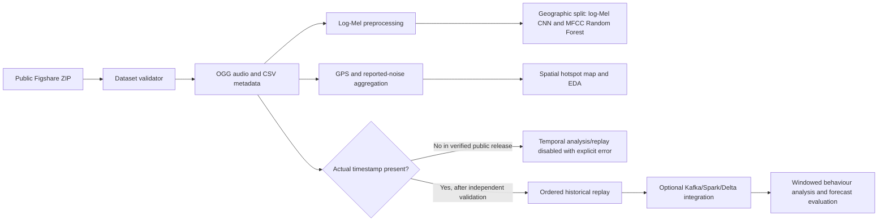

# Architecture and syllabus mapping

> **Scope notice (2026-11-01):** the Uganda workflow below remains separate. India includes a fully runnable local historical replay/analysis pipeline. It does not provide live monitoring, verified Chennai sensor coordinates, or Kattankulathur time-series modelling. See [final scope](./FINAL_PROJECT_SCOPE.md), [India audit](./INDIA_DATA_AUDIT.md), and [forecasting report](./FORECASTING_BASELINE_REPORT.md).

## Data flow

The current data flow, including its GPS map and audio-classification path, operates on Uganda source files only. Keep its artifacts separate from any future India data.



The public Figshare archive contains no timestamp in its metadata. The branch to chronological replay and time-dependent models is intentionally disabled for the verified release. The simulated sensor/data stream represents replayed historical observations only; it is not live microphone collection.

## India historical analysis path

```mermaid
flowchart LR
    A[CPCB-attributed 2011-2018 monthly CSVs] --> B[Schema, key, and station validation]
    B --> C[Chennai-only station-month panel]
    C --> D[Prior-only lag and rolling features]
    C --> E[Relative station hotspot behaviour]
    D --> F[One-month expanding-origin baselines]
    C --> G[Other-city descriptive comparison]
    C --> H[Chronological historical JSONL virtual source]
    H --> I[Schema-validated local event ingestion]
    I --> J[SQLite historical store]
    J --> K[Hotspot transitions and recurring patterns]
    J --> L[Persistence next-period estimate and heuristic range]
    K --> M[Local dashboard and static visualizations]
    L --> M
    N[TNPCB 2023-24 annual Leq summaries] -. Separate reference; no merge .-> O[Different annual Leq dB(A) product]
    P[SRMIST Jan 2025 day/night reference] -. Separate local context; no training .-> Q[One report-period pair]
```

The India path does not use or alter the Uganda audio/GPS pipeline. The laptop does not have Kafka, Spark Structured Streaming, or Delta Lake installed; the implemented local replacement is an ordered JSONL replay, schema validation, and SQLite persistence. The pipeline is synchronous batch replay, not an actual broker/streaming deployment. It cannot map sensor locations because exact site coordinates remain unresolved; hotspot output ranks station labels only. The CPCB-attributed Day/Night field semantics are unresolved, so outputs preserve neutral source-value terminology.

The separate presentation layer is `app.py` with reusable Streamlit pages/data helpers in `streamlit_app/`. It reads generated CSV/JSON outputs, uses cached read-only loaders, and sends user-triggered replay batches through the existing validator/SQLite upsert functions. Model/data computations remain in `src/urbannoise/`; the app does not duplicate model training logic or write to the database except via explicit replay action.

## Component choices

| Layer | Current implementation | Syllabus relationship and reason |
|---|---|---|
| Dataset acquisition | Figshare download, MD5 verification, safe selective ZIP extraction | IoT data collection and ingestion; the archive is small enough for a local project workflow. |
| Data contract | pandas CSV loader with strict required fields and optional validated timestamps | CSV and data quality / data collection design. |
| Audio processing | mono 16 kHz log-Mel CNN compared with an MFCC-summary Random Forest baseline | Deep learning, CNN, feature engineering, model comparison, PyTorch, scikit-learn. |
| Evaluation | Kampala-only labels, geographic group split, class-weighted loss, macro/per-class classification metrics | Limits label-provenance risk and nearby-location leakage. |
| Hotspot mapping | 250 m metric grid, GPS accuracy screen (100 m default), minimum cell sample count, reported-measurement summaries | Spatial aggregation and visual exploration. Cell thresholds are empirical, not legal noise standards. |
| IoT simulation | timestamp-validated JSON event envelopes and local chronological replay | Edge/ingestion concepts without physical sensors. The current public source cannot enter this branch due to missing timestamps. |
| India virtual source | JSONL events indexed by authentic `YYYY-MM` source periods; `is_live_measurement=false` | Historical software replay only; no fabricated timestamp or live sensor claim. |
| India local persistence | Event schema validation and idempotent SQLite storage | Runs with the standard library and provides durable local processing without paid services. |
| India intelligence | Station-level emergence/persistence/reduction, intensity-change, recurring-month, historical baseline, and next-period persistence outputs | Relative metrics only; future-frequency and forecast ranges are explicitly uncalibrated. |
| Kafka / Spark / Delta Lake | Not installed; optional scale-out architecture only | The available 5,005-row monthly source does not justify local cluster/broker setup. |
| Presentation | Streamlit entry point plus Plotly-based analysis views | Eight interactive research sections; all claims remain limited by source coverage/definitions. |

## Scientific constraints

- Reported measurement means and hotspot thresholds describe this dataset's samples, not a population-wide noise surface.
- Dataset documentation must be cited; do not describe the measurement as independently calibrated or weighted dB without source-method verification.
- The Hugging Face card says Entebbe labels are model-predicted; they are excluded from supervised ground-truth training by default.
- The India monthly period supports monthly behaviour and historical forecasting, but not within-month event timing. Uganda metadata still has no timestamp and remains blocked from temporal analysis.
- India localization constraint: the CPCB-attributed Chennai file is monthly and has no coordinates; the SRMIST report is a single January 2025 day/night reference. Do not feed either source into the Uganda GPS/audio pipeline or claim Kattankulathur hotspot forecasts.
- [`scripts/run_india_system.py`](./scripts/run_india_system.py) is the end-to-end entry point; it runs the analysis, ingests events into the local SQLite store, generates historical next-period estimates, hotspot timelines, source comparability outputs, and a static local dashboard. It is not a live-data pipeline.
