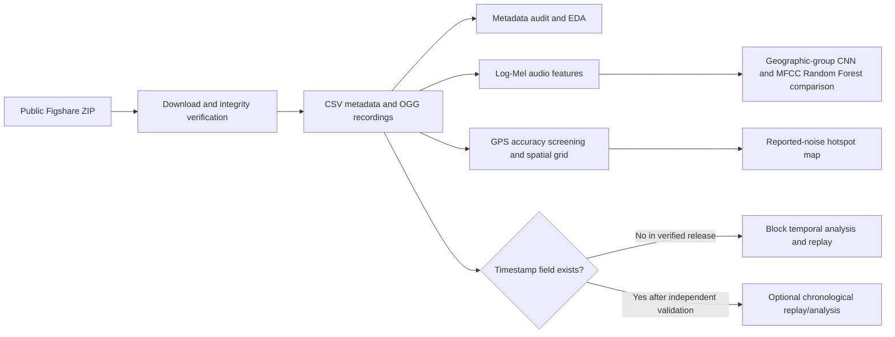

# AIoT-Based Urban Noise Hotspot Behaviour Modelling and Spatiotemporal Prediction

> **Scope notice (2026-11-01):** Sections describing the Uganda prototype are retained as a separate supplementary experiment. Its data, map, and pilot metrics are not Chennai/SRMIST observations or results. The hybrid India Phase 5 system and actual historical results are documented in [FINAL_PROJECT_SCOPE.md](./FINAL_PROJECT_SCOPE.md), [INDIA_DATA_AUDIT.md](./INDIA_DATA_AUDIT.md), [FORECASTING_BASELINE_REPORT.md](./FORECASTING_BASELINE_REPORT.md), and [ARCHITECTURE.md](./ARCHITECTURE.md). Chennai estimates are historical-only; no current forecast, verified sensor map, or Kattankulathur model is claimed.

## Abstract

This project develops a software-only AIoT workflow for urban noise source classification and geographic hotspot analysis using the public Urban Noise Uganda dataset. Its verified Figshare archive contains OGG recordings and metadata for Kampala and Entebbe, including category labels, GPS coordinates, GPS accuracy, and a dataset-reported noise measurement. The project implements strict metadata validation, audio feature extraction, a compact PyTorch CNN compared with an MFCC-feature Random Forest baseline, geographic evaluation splits, GPS-screened spatial aggregation, and interactive hotspot mapping. A local IoT-style event/replay interface is provided for genuine timestamped records.

An inspection of the public archive found 61,685 metadata rows, not the 61,821 claimed on the dataset landing page. More importantly, its public metadata contains no timestamp. Consequently, this release does not support valid temporal hotspot transitions, timestamp-ordered replay, or future forecasting. The implementation disables these claims rather than inferring dates or fabricating observations. A 1,200-row Kampala pilot compared a log-Mel CNN with an MFCC Random Forest; the baseline performed better in this limited run, so these initial metrics are not presented as definitive model performance. The contribution supported by the evidence is source classification and retrospective mapping of sampled reported noise measurements. Measurement weighting/calibration and sampling representativeness also remain limitations.

The project has since adopted a hybrid India scope without changing the Uganda implementation. A separate Chennai pipeline uses the CPCB-attributed 2011–2018 monthly station file for descriptive relative hotspot behaviour and one-month-ahead historical baseline backtests. Day/Night definitions and exact sensor coordinates remain unresolved; the experiments therefore use neutral source-value labels and do not produce a geographic heatmap or current forecast. SRMIST/Kattankulathur is a separate one-off local reference, and other Indian city labels are compared descriptively. See the [data dictionary](./DATA_DICTIONARY.md) and [geography audit](./STATION_GEOGRAPHY_AUDIT.md).

## Current hybrid India scope (separate from the Uganda prototype)

The current geographic scope is Chennai as the primary historical modelling region, SRMIST Kattankulathur as a separate local reference, and other Indian source-city labels for comparison. Phase 3 implemented prior-only Chennai features, station-level relative Day/Night summaries, persistence and learned-model baselines, per-station historical test scores, city comparisons, and historical monthly JSONL replay. The actual metrics, train/validation/test periods, and limitations are in [FORECASTING_BASELINE_REPORT.md](./FORECASTING_BASELINE_REPORT.md). This does not constitute a live IoT stream, contemporary Chennai forecast, legally calibrated noise assessment, or reliable sensor-location map.

## Phase 4 local intelligence integration

The runnable local system entry point is `scripts/run_india_system.py`. It regenerates the source-separated India analysis, emits ordered historical monthly JSONL virtual events, validates and idempotently stores them in SQLite, produces station-level hotspot transition/recurrence outputs, writes a persistence extension for the period after the last source observation, and generates a static dashboard at `outputs/india/system/index.html`. For the available source, the next period is January 2019; that is not a current forecast. Its recent hotspot frequency and historical-error range are explicitly uncalibrated proxies.

TNPCB annual Leq dB(A) and SRMIST report-period values are shown in a separate-source table and never pooled with the CPCB-attributed series. The current laptop has Java 21 but no Kafka broker, Spark/PySpark, or Delta Lake runtime; the local Python/SQLite pipeline is the implemented architecture. See the [draft data access request](./DATA_ACCESS_REQUEST_DRAFT.md); it has not been submitted.

## Phase 5 Streamlit application

The local [Streamlit app](./app.py) presents eight interactive sections over generated system outputs: overview; Chennai behaviour; station-level hotspot intelligence; historical predictive analytics; India comparisons; controlled historical replay; separate SRMIST case study; and methodology/data sources. Plotly charts, filters, tables, and downloads operate on validated artifacts. Replay is user-triggered and calls the existing validator and idempotent SQLite store. Source-definition, coordinate, temporal, and no-live-data safeguards are preserved throughout.

## 1. Introduction and motivation

Urban noise is produced by sources whose location and intensity can vary with activity and time. Noise-monitoring networks and acoustic classification can support urban planning, but defensible analysis depends on the observation fields a dataset actually supplies. In many public audio corpora, source labels are available without GPS or collection time; conversely, georeferenced noise-level data may not include audio or source labels.

The selected Uganda dataset is valuable because its public release includes audio, categories, geolocation, and a noise measurement field. The system uses those verified fields for software-based analysis and avoids presenting a historical-data replay as a live physical sensor system.

## 2. Problem definition

Given a labelled urban audio recording and its metadata, classify its urban source category and summarize the spatial distribution of sampled noise measurements. Determine whether the public data support temporal hotspot behaviour and future forecasting before attempting those tasks.

For the Figshare release inspected here, temporal prediction is not a valid supervised problem: timestamps are absent from `metadata.csv`. The title's spatiotemporal ambition is therefore treated as a research objective whose feasibility is tested, not as a result that can be claimed from this release.

## 3. Objectives

1. Validate and document the public dataset and its licensing.
2. Build reusable audio and metadata preprocessing.
3. Train and evaluate an urban sound-source classifier using the Kampala-labelled subset.
4. Map geographic concentrations and summaries of dataset-reported noise measurements.
5. Implement explicit timestamp guards for any time-dependent analysis or simulated replay.
6. Clearly separate software replay of historical data from actual live IoT collection.
7. Report dataset, annotation, sampling, and measurement limitations.

## 4. Related work and candidate datasets

### 4.1 Urban Noise Uganda 61K

The dataset record describes 61,821 georeferenced urban sound recordings from Kampala and Entebbe, with noise measurements, location, and categories. Its Figshare ZIP is publicly downloadable under CC BY 4.0. Parsing the actual archive metadata produced 61,685 rows and 61,685 OGG files. The CSV includes 19 observed categories and no timestamp column. These release/count/time discrepancies are documented in [DATASET_FEASIBILITY.md](./DATASET_FEASIBILITY.md).

### 4.2 SONYC-UST v2.3

SONYC-UST v2.3 provides multi-label ten-second recordings from a New York City acoustic sensor network with block-level and hourly context. It is an optional, separate-domain acoustic tagging source; its labels and recordings are not merged with Uganda as if they were from a common location or taxonomy. The released recordings were selected around known sound classes and do not provide calibrated SPL.

### 4.3 UrbanSound8K

UrbanSound8K contains 8,732 short recordings from ten classes, but no geographic coordinates or recording timestamps. It is suitable for sound-classification benchmarking, not geographic hotspot or temporal forecasting.

## 5. Existing and proposed systems

### Existing approach

Simple noise-monitoring dashboards display a sound measurement at a point or alert at a fixed threshold. Audio classification datasets without spatial/time metadata cannot explain geographic concentration. This project joins the fields that the Uganda public release actually provides while keeping their provenance visible.

### Proposed system



The software ingestion boundary can be adapted to a broker or distributed processing platform if a future timestamped source warrants it. Kafka, Spark, Delta Lake, GraphFrames, a cloud IoT hub, and physical sensors are not required for this local dataset workflow.

## 6. Dataset and preprocessing

### 6.1 Verified metadata

The metadata audit script reports row counts, label and region distributions, missing fields, coordinate repetition, measurement distribution, and GPS accuracy. Observed counts in the public release:

- 61,685 rows: 37,512 Kampala and 24,173 Entebbe.
- 19 categories in the metadata.
- 60,581 exact coordinate pairs; 518 pairs repeat, covering 1,622 observations.
- Dataset-reported `noise_measurement`: minimum 1, median 48, maximum 84.
- GPS accuracy: median 4.2 m, 95th percentile 6.3 m, maximum 2,799.999 m.
- No date/time/timestamp field in the public CSV.

The dataset card says Kampala labels are hand-labelled and Entebbe labels are model-predicted, though its label-semantics text is not fully consistent. Training therefore uses Kampala only by default; Entebbe remains available for exploratory mapping with its label provenance caveat.

### 6.2 Audio

The public archive contains OGG recordings. The training pipeline decodes audio to mono 16 kHz, uses up to five seconds per recording, computes a 64-bin log-Mel spectrogram, and pads/truncates features to a fixed model input shape. Audio files are read by filename from the extracted archive; missing files are reported rather than silently removed.

### 6.3 Geographic aggregation

The hotspot analysis projects GPS coordinates to a local metric grid (250 m default), excludes observations with reported horizontal accuracy above 100 m by default, retains cell sample counts and mean GPS accuracy, and computes mean/median/90th percentile of the dataset-reported measurement. Candidate hotspots are cells in the top decile of cell mean values among cells meeting the minimum count. This is a relative exploratory criterion, not a regulatory threshold.

## 7. Modelling methodology

### 7.1 Source classification

The primary classifier is a compact CNN applied to log-Mel features. It uses a single class per recording, matching the Uganda metadata's category field. The Kampala subset is divided using nested `GroupShuffleSplit` partitions grouped by coordinates rounded to 0.001 degrees, reducing nearby-location leakage across train, validation, and test. Class-weighted cross entropy addresses imbalance. A Random Forest using the mean and standard deviation of 20 MFCC coefficients provides a structured-feature baseline, trained and evaluated on the same geographic split as the CNN. Evaluation outputs include per-class precision/recall/F1, macro/weighted aggregates, confusion matrices, and CNN train/validation loss curves.

### 7.2 Hotspot behaviour and forecasting

The code includes transition analysis for data that passes timestamp validation: emergence, persistence, intensification, disappearance, and an adjacent-cell shift heuristic. These functions are unit-tested on explicitly synthetic test fixtures, not presented as empirical Uganda results. The public Figshare data have no timestamps; therefore no transitions or future forecasts are reported for this dataset.

If an authorized timestamped source is supplied, assess its actual temporal span, repeat count per region/time window, gaps, and chronological holdout before training a forecaster. Compare against persistence before using XGBoost/LSTM. Do not infer timestamps from file order.

### 7.3 IoT simulation

The local JSON event interface models an observation as an ingestion message only when a genuine timestamp is available. The included replay command sorts by source timestamp and emits JSONL. The verified public metadata currently fails this prerequisite. This is a historical-data software simulation, not live microphone sensing.

## 8. Implementation and reproducibility

Install dependencies and the package using the commands in [README.md](./README.md). Dataset acquisition verifies the official Figshare MD5 and extracts only metadata/OGG files. A metadata-only option uses bounded HTTP byte ranges and validates the metadata member's ZIP CRC without downloading the whole archive.

Useful commands:

```powershell
python scripts\download_dataset.py --metadata-only
python scripts\analyze_dataset.py
python scripts\create_hotspot_map.py
python scripts\train_classifier.py --epochs 5 --max-samples 4000
python scripts\replay_iot.py
python -m unittest discover -s tests -v
```

The replay command is expected to stop with an explicit missing-timestamp error on the verified Figshare release.

## 9. Experimental results

### 9.1 Metadata and spatial analysis

The actual metadata audit and spatial aggregation are run by `scripts/analyze_dataset.py`; the interactive map is created by `scripts/create_hotspot_map.py`. At the default settings used during development (250 m grid, minimum five observations, GPS accuracy at most 100 m), actual metadata yielded 1,000 populated grid cells and 100 top-decile candidate cells. These are sample summaries and are not estimates of city-wide exposure.

### 9.2 Classifier results

The executed pilot command was `python scripts\train_classifier.py --epochs 2 --batch-size 32 --max-samples 1200` (seed 42, CPU). It sampled 1,200 Kampala recordings and used the same geographic group split for both models: 762 training, 198 validation, and 240 test recordings.

| Model | Test accuracy | Macro F1 | Weighted F1 |
|---|---:|---:|---:|
| Log-Mel CNN (2 epochs) | 14.58% | 10.29% | 11.94% |
| MFCC-summary Random Forest | 38.33% | 35.67% | 41.78% |

The Random Forest was stronger in this small pilot. The CNN's two epochs are not enough to conclude that the architecture is intrinsically inferior; the sample was randomly selected before splitting, class representation is uneven, and neither model has been tuned. Treat these numbers as a reproducible baseline, not a deployment estimate. Both classification reports are in `models/classification_metrics.json`; the CNN checkpoint, Random Forest model, training curves, and CNN confusion-matrix plot are also saved in `models/`.

### 9.3 Forecast feasibility

Not supported by the verified Figshare CSV: the required timestamp column is absent. No future-horizon MAE/RMSE/F1 or chronological forecast score is produced.

## 10. Limitations

- The Figshare description reports 61,821 samples while the actual ZIP metadata and audio count are 61,685.
- The Hugging Face card advertises timestamp metadata and 59,731/1,000 sample configurations, but requires account access approval and could not be inspected anonymously. The listed sizes do not reconcile with the Figshare release.
- The public Figshare CSV contains no timestamps; temporal hotspot behaviour, chronological replay, and forecasting are blocked.
- Exact GPS coordinates are mostly unique; repeated points are sparse. Spatial cell results depend on grid size, count threshold, GPS accuracy filtering, and the survey's sampling pattern.
- The `noise_measurement` field is called SPL by the dataset record/card, but the inspected CSV does not specify weighting, units, or calibration. The low minimum and measurement provenance require caution.
- Entebbe class labels have model-label provenance according to the Hugging Face card; they are excluded from supervised ground-truth training by default.
- The release is observational and collection coverage may be non-uniform; do not interpret sample counts as population prevalence.
- The compact CNN and selected sample limit are intended for a reproducible academic pilot, not a deployed municipal monitoring service.

## 11. Conclusion and future work

The public Uganda release provides useful real audio, source categories, coordinates, GPS accuracy, and a reported noise measurement for classification and retrospective spatial analysis. The data audit identified a key feasibility boundary: despite one dataset card describing timestamps, the public Figshare archive examined here has none. Honest implementation therefore stops short of temporal forecasting and timestamp-ordered streaming. Future work can resume those phases only after a timestamped release is accessible, its authorization and measurement provenance are confirmed, and repeated spatial-temporal observations support a leakage-free chronological test.

## References

1. Nsumba, S. et al. “Noise mapping and ambient sound recordings of the urban environment in Uganda.” *Scientific Data* 13, 345 (2026). [https://doi.org/10.1038/s41597-026-06658-w](https://doi.org/10.1038/s41597-026-06658-w).
2. Nsumba, S. et al. *Urban Noise Uganda 61K*. Figshare dataset, CC BY 4.0. [https://doi.org/10.6084/m9.figshare.30168901.v1](https://doi.org/10.6084/m9.figshare.30168901.v1).
3. Sunbird AI. [Urban Noise Uganda 61K Hugging Face dataset card](https://huggingface.co/datasets/Sunbird/urban-noise-uganda-61k).
4. Cartwright, M. et al. “SONYC-UST-V2: An Urban Sound Tagging Dataset with Spatiotemporal Context.” DCASE 2020. [https://arxiv.org/abs/2009.05188](https://arxiv.org/abs/2009.05188).
5. Cartwright, M. et al. [SONYC-UST v2.3 dataset](https://doi.org/10.5281/zenodo.3966543).
6. Salamon, J., Jacoby, C., and Bello, J. P. “A Dataset and Taxonomy for Urban Sound Research.” ACM Multimedia 2014. [UrbanSound8K dataset page](https://urbansounddataset.weebly.com/urbansound8k.html).
