<h1 align="center">🔊 NoiseScope Chennai</h1>

<h3 align="center">
AIoT-based urban sound source classification and spatiotemporal noise hotspot prediction<br/>
using real acoustic sensor data from Chennai
</h3>

<p align="center">
  <a href="https://noisescope.streamlit.app/"></a>
</p>

<p align="center">
  
  
  
  
  
  
  
  
</p>

<p align="center">
  <a href="#overview">Overview</a> •
  <a href="#results">Results</a> •
  <a href="#architecture">Architecture</a> •
  <a href="#screenshots">Screenshots</a> •
  <a href="#quick-start">Quick start</a> •
  <a href="#docs">Docs</a>
</p>

<p align="center">
  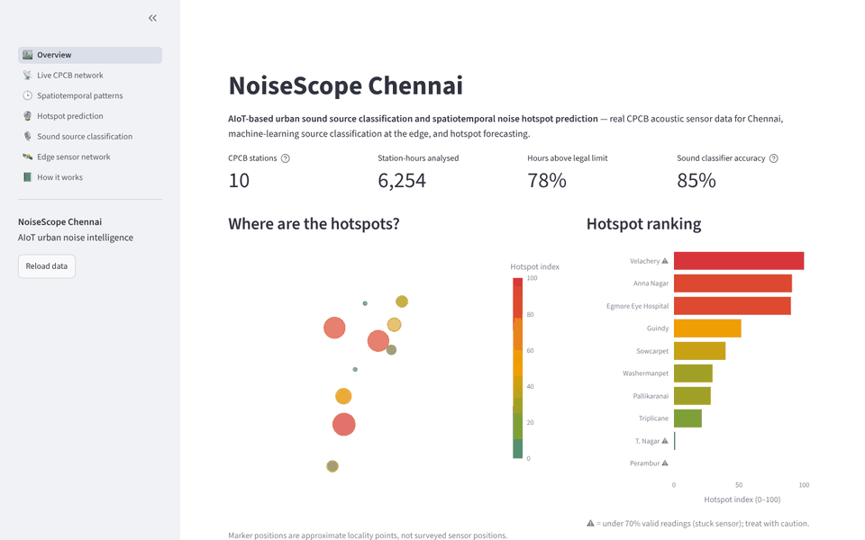
</p>

---

<a id="overview"></a>

## 🌆 Overview

Chennai's streets are exposed to noise all day and all night: traffic, horns, construction, sirens, markets and festivals. Conventional monitoring reports a single decibel number. It does not say **what** is making the noise, or **where and when** it becomes a problem.

**NoiseScope** is an end-to-end AIoT system that:

| | Capability | How |
|---|---|---|
| 📡 | **Collects real acoustic sensor data** | The 10 Chennai stations of the CPCB *National Ambient Noise Monitoring Network*, at 10-minute resolution, with a live connector to the CPCB portal |
| 🎙️ | **Classifies urban sound sources** | A machine-learning model on edge devices recognises 8 urban source types: traffic, horns, sirens, construction, people, bells, animals and nature |
| 🕒 | **Analyses spatial and temporal patterns** | Hourly LAeq, day/night levels, legal-limit exceedance, hour × weekday rhythms and hotspot episodes |
| 🔮 | **Predicts noise hotspots** | Forecasts each station's noise level, with an 80% range and hotspot probability, 1–24 hours ahead |
| 🛡️ | **Checks its own data** | Automatically detects frozen ("stuck") sensors and keeps them out of the results |
| 🖥️ | **Presents it all** | A 7-page interactive dashboard, deployed online |

> **Problem statement**: Urban areas are continuously exposed to noise generated by traffic, construction activities, emergency vehicles, machinery, human activities and other urban sources. This project proposes an AIoT-based urban acoustic monitoring system that uses acoustic sensor data and machine learning to classify urban sound sources, analyse their spatial and temporal distribution, and identify and predict noise hotspots from historical sound patterns, enabling data-driven noise management.

---

<a id="results"></a>

## 🏆 Key results

<table>
<tr>
<td width="50%" valign="top">

### 🎙️ Sound source classifier

| Metric | Score |
|---|---|
| Accuracy | **84.6%** |
| Balanced accuracy | 81.6% |
| Macro-F1 | 0.833 |
| Categories | 8 urban sources |
| Validation | ESC-50 official 5-fold CV |

</td>
<td width="50%" valign="top">

### 🔮 Hotspot forecaster

| Horizon | Error (MAE) | vs. "same as now" |
|---|---|---|
| 1 h | 2.48 dB | 2.39 dB |
| 6 h | **3.55 dB** | 5.21 dB (−32%) |
| 12 h | **3.84 dB** | 6.18 dB (−38%) |
| Hotspot AUC | **0.94 – 0.98** | |

</td>
</tr>
</table>

<p align="center">
  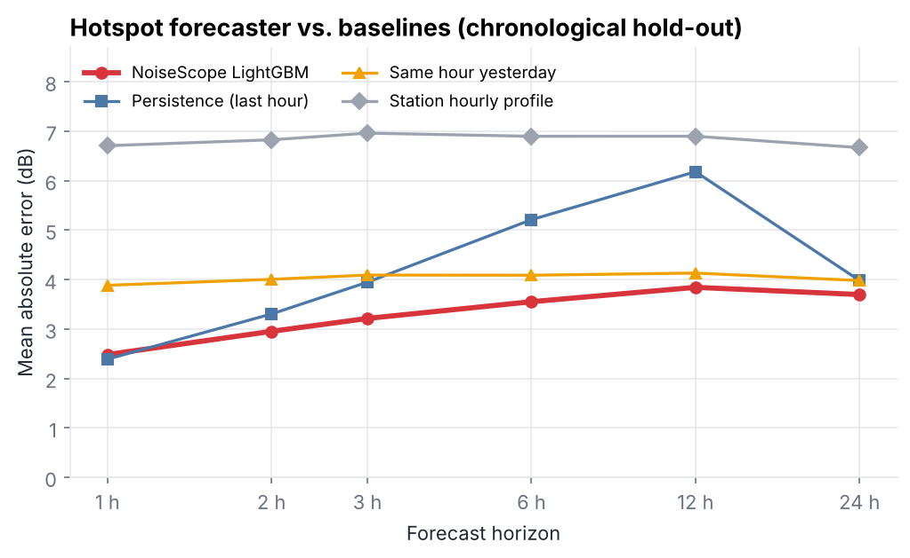
  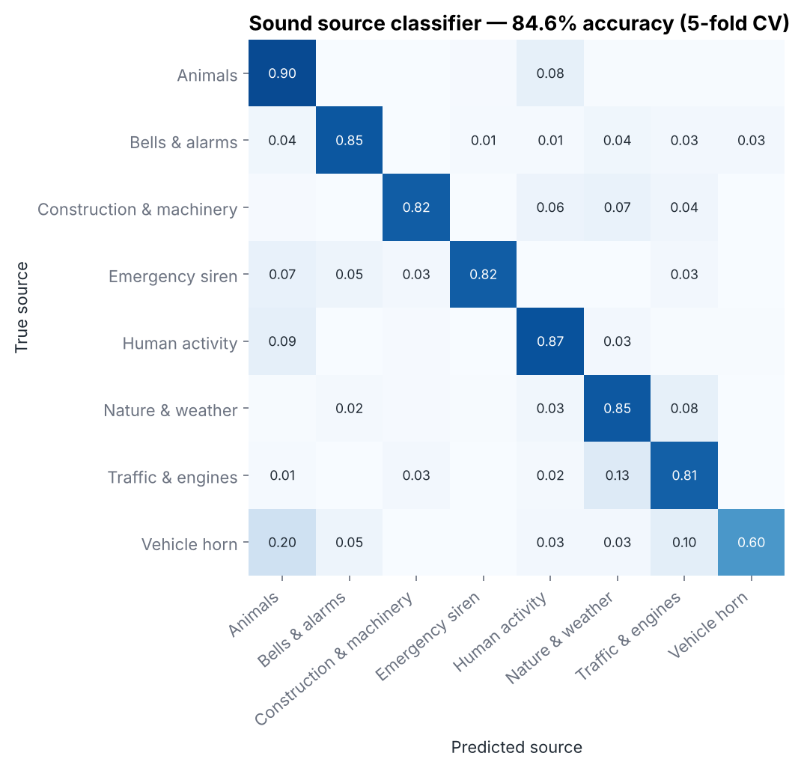
</p>

### 🏙️ What the Chennai data reveals

<p align="center">
  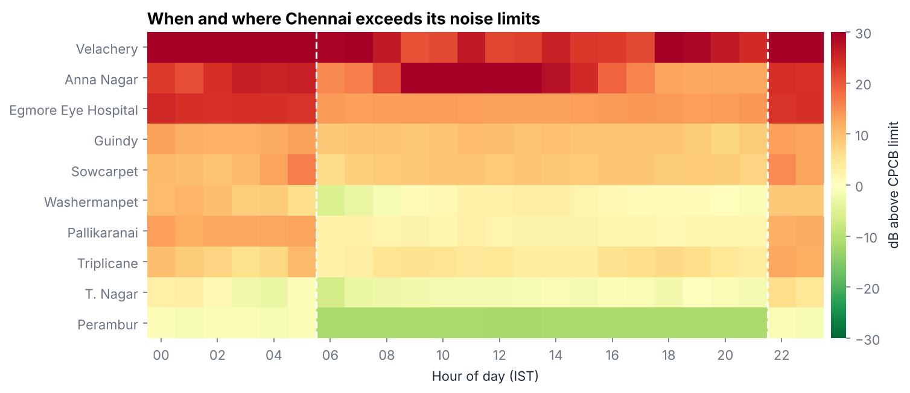
</p>

- 🔴 **78% of station-hours exceed the legal noise limit** (Noise Pollution Rules, 2000).
- 🏥 **Silence zones get the least protection.** Egmore Eye Hospital and Anna Nagar are hotspots for most of the day *and* night.
- 🎆 Anna Nagar's worst hours fall on **14–19 January (Bhogi / Pongal)**, with 10-minute levels above 100 dB.
- 🌙 Nights are the biggest compliance gap: night limits are 10 dB stricter, but the city barely gets quieter.
- 🛠️ **Three sensors (T. Nagar, Velachery, Perambur) froze for days.** NoiseScope detects this automatically and excludes the frozen readings ([see how](docs/METHODOLOGY.md#3-data-quality-control)).

➡️ Full analysis in **[docs/RESULTS.md](docs/RESULTS.md)**

---

<a id="architecture"></a>

## 🏗️ System architecture

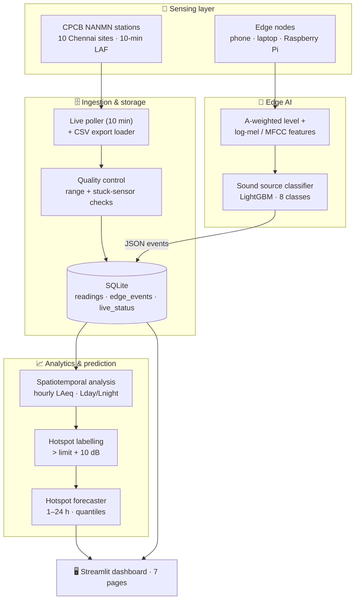

**Edge-first design.** Edge nodes classify sound on the device and send only small JSON events (time, place, level, source), never raw audio. That keeps bandwidth low and privacy high. CPCB stations tell us **where and when** it is loud; edge nodes tell us **what** is causing it.

➡️ Details in **[docs/ARCHITECTURE.md](docs/ARCHITECTURE.md)**

---

<a id="screenshots"></a>

## 🖼️ Screenshots

<table>
<tr>
<td width="50%"><b>🏙️ Overview: hotspot map and ranking</b><br/>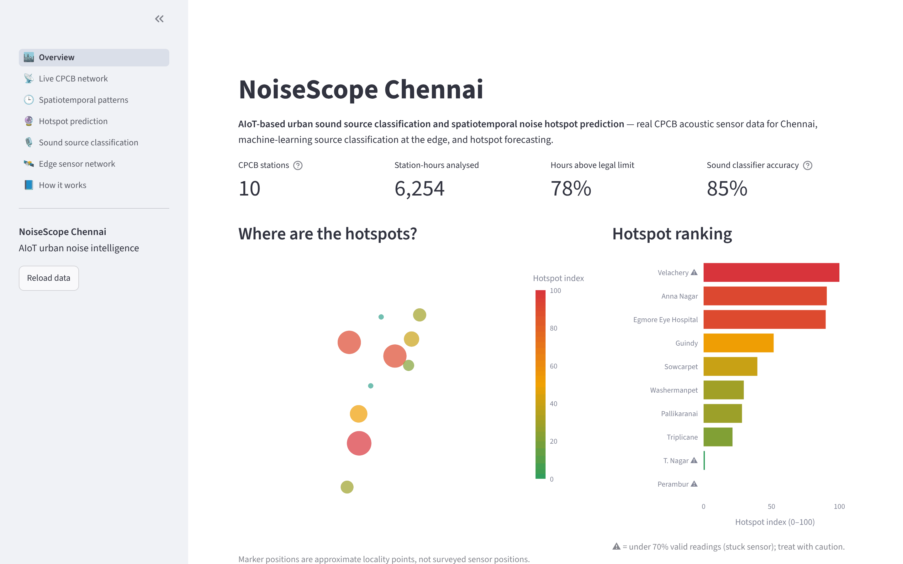</td>
<td width="50%"><b>🕒 Spatiotemporal patterns</b><br/>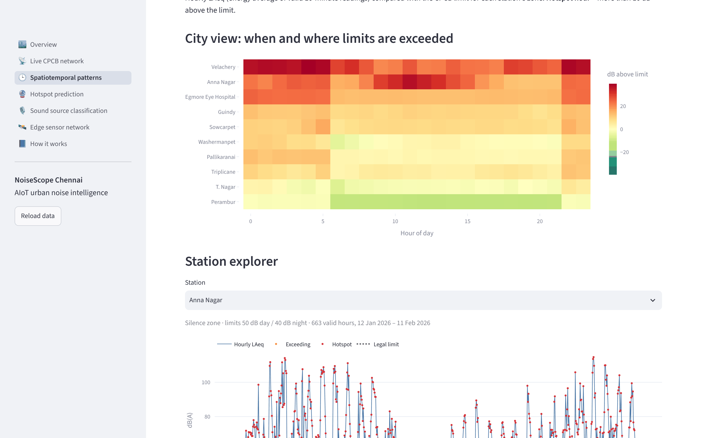</td>
</tr>
<tr>
<td><b>🔮 Hotspot prediction: 24-hour outlook</b><br/>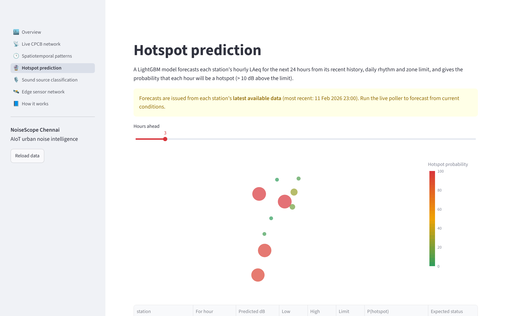</td>
<td><b>📊 Forecast backtest vs. baselines</b><br/>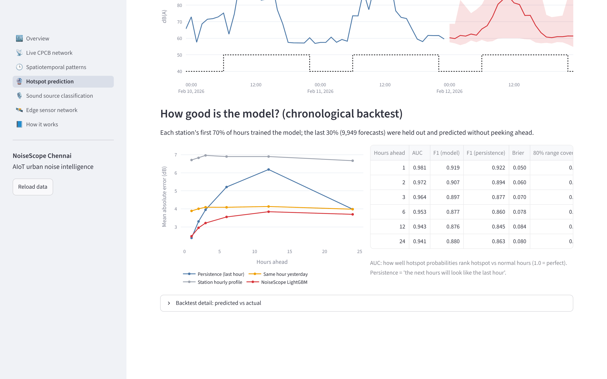</td>
</tr>
<tr>
<td><b>🎙️ Sound source classification</b><br/>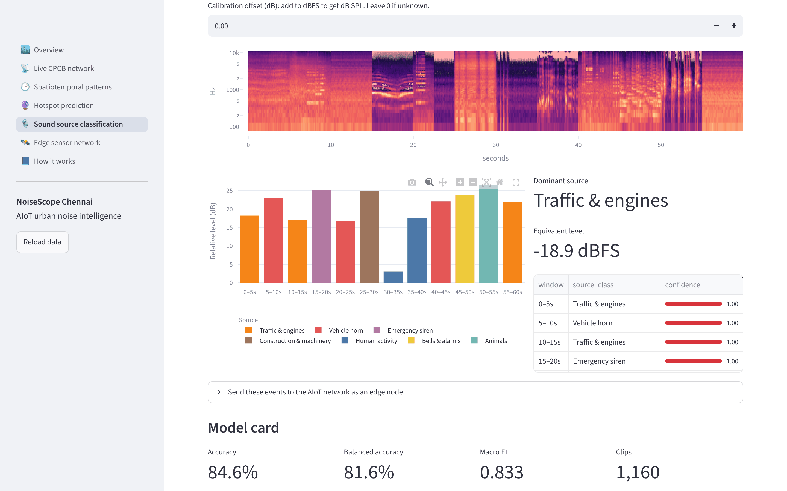</td>
<td><b>🛰️ Edge network: what makes each place loud</b><br/>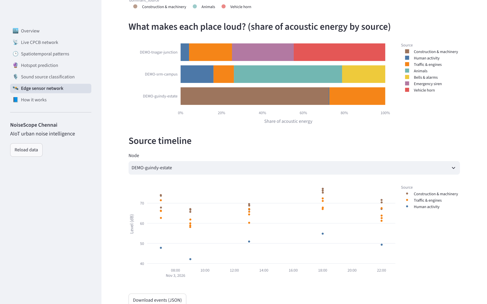</td>
</tr>
</table>

➡️ Page-by-page walkthrough in **[docs/USER_GUIDE.md](docs/USER_GUIDE.md)**

---

<a id="quick-start"></a>

## 🚀 Quick start

**Live demo:** https://noisescope.streamlit.app/

**Run locally** (Python 3.10+, tested on 3.12):

```bash
git clone https://github.com/umugash/AI-IOT-Project.git
cd AI-IOT-Project
pip install -r requirements.txt
streamlit run app.py
```

The database builds itself from the bundled CPCB data on first launch. The trained models are included.

**Collect live Chennai data** (run on your laptop; the CPCB portal must be reachable):

```bash
python scripts/poll_cpcb_live.py --interval 600
```

**Turn your phone into an acoustic sensor.** Record a clip, then:

```bash
python scripts/edge_node.py --node-id srm-main-gate --lat 12.8231 --lon 80.0442 --audio recording.wav
```

➡️ More options in **[docs/DEPLOYMENT.md](docs/DEPLOYMENT.md)**

---

<a id="docs"></a>

## 📚 Documentation

| Document | What's inside |
|---|---|
| 🏗️ [ARCHITECTURE.md](docs/ARCHITECTURE.md) | Layers, data flow, storage schema, module map, design decisions |
| 🗃️ [DATA.md](docs/DATA.md) | Data sources, the 10 CPCB stations, data dictionary, quality control |
| 🧪 [METHODOLOGY.md](docs/METHODOLOGY.md) | Sound classification, acoustics, hotspot definition, forecasting, evaluation |
| 📊 [RESULTS.md](docs/RESULTS.md) | All metrics, figures and findings |
| 🖥️ [USER_GUIDE.md](docs/USER_GUIDE.md) | Every dashboard page explained, with screenshots |
| 🚀 [DEPLOYMENT.md](docs/DEPLOYMENT.md) | Local run, Streamlit Cloud, live poller, edge nodes, Raspberry Pi, MQTT |
| 🛠️ [DEVELOPMENT.md](docs/DEVELOPMENT.md) | Project structure, tests, retraining models, extending the system |

---

## 🛠️ Tech stack

| Layer | Technologies |
|---|---|
| Machine learning | LightGBM (classification, quantile regression), scikit-learn |
| Audio processing | librosa (log-mel, MFCC, spectral features, A-weighting), soundfile |
| Data & storage | pandas, NumPy, SQLite |
| IoT & ingestion | requests (CPCB portal), JSON events, optional MQTT (paho-mqtt), sounddevice |
| Visualisation | Streamlit, Plotly, Matplotlib |
| Quality | pytest |

---

## 🌍 Impact

NoiseScope supports evidence-based noise management for Indian cities. It shows regulators **which sites break the limits, at what hours, and from which sources**, and warns them **before** a hotspot forms.

- **SDG 3: Good Health & Well-being.** Chronic noise exposure is linked to sleep disturbance, stress and cardiovascular disease.
- **SDG 11: Sustainable Cities & Communities.** Data-driven urban environmental monitoring.

---

## 🔮 Future work

- Fine-tune the classifier on **locally recorded Chennai audio** (auto-rickshaw and bus horns, temple bells, metro construction), or use pretrained audio embeddings (YAMNet / PANNs)
- Deploy **Raspberry Pi edge nodes beside CPCB stations** to fuse source labels with official levels directly
- Run the live poller continuously to build a **multi-month aligned record** for seasonal and festival modelling
- Spatial interpolation once surveyed sensor coordinates are available
- Alerting (SMS / Telegram) when the forecast hotspot probability crosses a threshold

---

## 📄 Data credits

- **CPCB National Ambient Noise Monitoring Network**, http://cpcbnoise.com (public guest access)
- **ESC-50**: K. J. Piczak, *ESC: Dataset for Environmental Sound Classification*, ACM MM 2015, CC BY-NC 3.0. The sound model and demo audio derive from it, so use them for non-commercial purposes only.
- Tamil Nadu Pollution Control Board Annual Report 2023-24; SRMIST air and noise monitoring report (January 2025)

---

## 👥 Authors

**Mugash Priyan U**, SRM Institute of Science & Technology

<!-- Add team members and project guide here -->

---

<p align="center">⭐ If you found this project useful, give it a star!</p>
