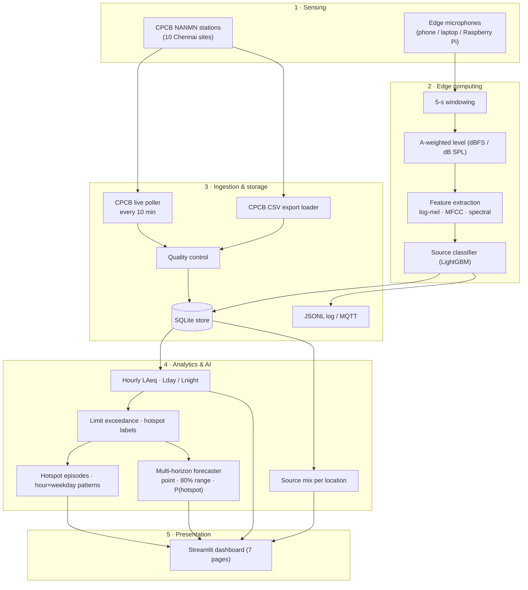
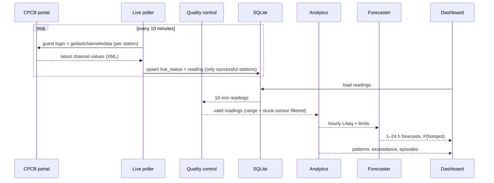
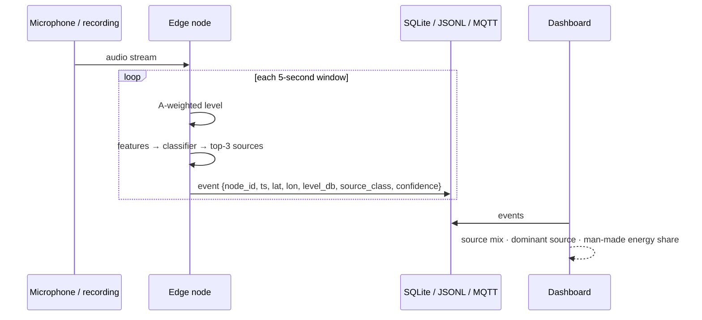
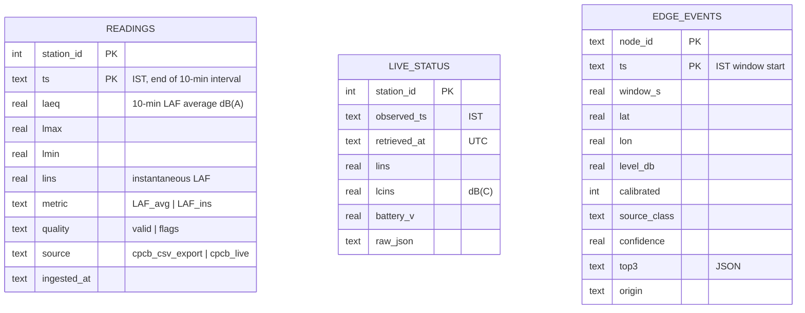
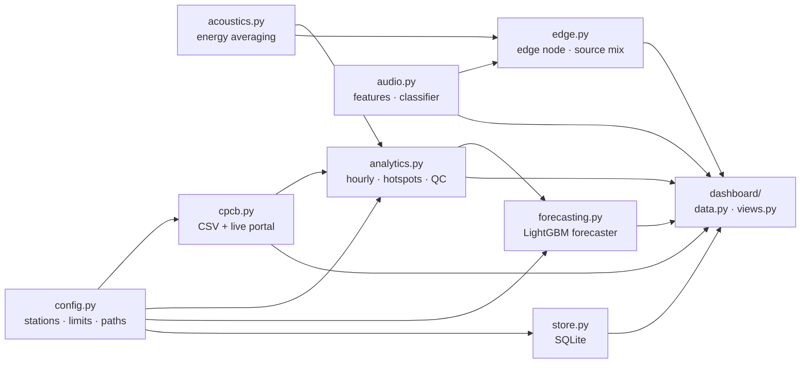

# 🏗️ Architecture

[← Back to README](../README.md) · [Data](DATA.md) · [Methodology](METHODOLOGY.md) · [Results](RESULTS.md) · [User guide](USER_GUIDE.md) · [Deployment](DEPLOYMENT.md) · [Development](DEVELOPMENT.md)

---

## 1. Layered AIoT design

NoiseScope follows the classic AIoT stack: **sense → compute at the edge → ingest & store → analyse & predict → present**.

| Layer | Component | Code |
|---|---|---|
| Sensing | CPCB 10-minute LAF readings | `data/cpcb/raw/`, live portal |
| Sensing | Microphone or audio file | `scripts/edge_node.py`, dashboard recorder |
| Edge | Level, features, classification | `src/noisescope/audio.py`, `src/noisescope/edge.py` |
| Ingestion | CSV parser, live poller | `src/noisescope/cpcb.py`, `scripts/poll_cpcb_live.py` |
| Quality | Range checks, stuck-sensor detection | `cpcb.quality_flags`, `cpcb.flag_flatlines` |
| Storage | SQLite (3 tables) | `src/noisescope/store.py` |
| Analytics | Hourly levels, exceedance, hotspots, episodes | `src/noisescope/analytics.py` |
| Prediction | LightGBM forecaster + baselines | `src/noisescope/forecasting.py` |
| Presentation | Dashboard | `app.py`, `dashboard/` |

---

## 2. Data flows

### 2.1 Official station data (where & when)

### 2.2 Edge acoustic data (what)

An edge event is about 300 bytes, while 5 seconds of raw 22 kHz audio is about 220 kB. Sending events instead of audio cuts bandwidth by roughly **700×**, and no recognisable speech ever leaves the device.

---

## 3. Storage schema

- **Idempotent writes.** Primary keys plus `INSERT OR REPLACE` mean that re-running an import or poll never creates duplicates.
- **Failed polls are never stored**, so the last good live reading is always kept.
- The database (`data/noisescope.db`) is generated and git-ignored. It rebuilds automatically from `data/cpcb/raw/`.

---

## 4. Module map

---

## 5. Key design decisions

| Decision | Why |
|---|---|
| **LightGBM for both tasks** | Strong on tabular features, fast on a laptop CPU, no GPU needed, and the model saves as plain text that loads across library versions |
| **Forecast the *change* from the current level** | Makes "no change" the model's starting point; together with stronger regularisation it cut 1-hour MAE from 3.15 to 2.48 dB |
| **One direct multi-horizon model** | Horizon is a feature; avoids error build-up from recursive forecasting |
| **Quantile models for the range** | A data-driven 80% range; the 5th/95th percentile pair achieves 82–85% real coverage |
| **SQLite instead of Kafka / Spark** | Ten stations every 10 minutes is about 1,440 rows a day; a broker or cluster would add cost and complexity without benefit. The edge events already follow an MQTT-ready envelope for scale-out |
| **Classify at the edge** | Privacy (no raw audio leaves the device), about 700× less bandwidth, works offline |
| **Pre-trained models committed** | The hosted app starts in seconds with no training on first visit |
| **Automatic stuck-sensor detection** | Real Chennai sensors froze for days; without it a broken sensor would top the hotspot ranking |
