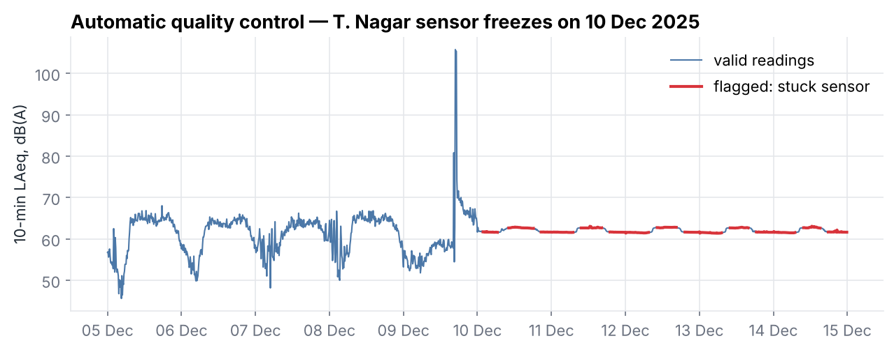

# 🗃️ Data

[← Back to README](../README.md) · [Architecture](ARCHITECTURE.md) · [Methodology](METHODOLOGY.md) · [Results](RESULTS.md) · [User guide](USER_GUIDE.md) · [Deployment](DEPLOYMENT.md) · [Development](DEVELOPMENT.md)

---

## 1. Sources at a glance

| Source | What it gives | Role in NoiseScope | Location in repo |
|---|---|---|---|
| **CPCB National Ambient Noise Monitoring Network (NANMN)**, CSV exports | 10-minute A-weighted levels (LAF) for 10 Chennai stations | Spatiotemporal analysis, hotspots, forecasting | `data/cpcb/raw/` |
| **CPCB NANMN live portal** (`cpcbnoise.com`, guest access) | Latest channel values per station | Live status, current-condition forecasts | `data/cpcb/live_snapshots/` + live poller |
| **ESC-50** (Piczak 2015, CC BY-NC 3.0) | 2,000 labelled 5-second environmental sound clips, 50 classes | Training the sound source classifier (1,160 clips → 8 urban categories) | Downloaded by `scripts/train_sound_classifier.py` |
| **Edge recordings** (yours) | Audio from a phone or other microphone, with time and place | Source attribution at specific locations | `edge_events` table |
| TNPCB Annual Report 2023-24 | Annual day/night Leq per Chennai station | Context and cross-check only | `data/reference/` |
| SRMIST monitoring report, January 2025 | Campus day/night ambient levels | Local reference only | `data/reference/` |

---

## 2. The ten CPCB Chennai stations

| ID | Station | Portal name | Zone | Limits day/night dB(A) | Data period | 10-min readings | Metric | Valid after QC |
|---|---|---|---|---|---|---|---|---|
| 264 | Egmore Eye Hospital | Chennai_Eye Hospital Pudupet | Silence | 50/40 | 01 Sep 2025 – 30 Sep 2025 | 4,313 | LAF_avg | 100% |
| 265 | T. Nagar ⚠ | Chennai_Thiyagaraya Nagar | Commercial | 65/55 | 01 Dec 2025 – 31 Dec 2025 | 4,464 | LAF_avg | 46% |
| 266 | Perambur ⚠ | Chennai_Perambur Paper Mill Rd. | Commercial | 65/55 | 01 May 2025 – 31 May 2025 | 4,426 | LAF_avg | 58% |
| 267 | Guindy | Chennai_Guidy Mount Salai | Industrial | 75/70 | 01 Jan 2026 – 01 Feb 2026 | 4,463 | LAF_avg | 98% |
| 268 | Triplicane | Chennai_Ice House Triplicane | Residential | 55/45 | 01 May 2025 – 31 May 2025 | 4,463 | LAF_ins¹ | 100% |
| 269 | Pallikaranai | Chennai_Pallikaranai | Commercial | 65/55 | 01 Jan 2026 – 01 Feb 2026 | 4,465 | LAF_avg | 100% |
| 270 | Velachery ⚠ | Chennai_Velacherry | Residential | 55/45 | 01 Jan 2026 – 31 Jan 2026 | 4,395 | LAF_avg | 54% |
| 271 | Washermanpet | Chennai_Washermanpet | Commercial | 65/55 | 01 Jan 2026 – 01 Feb 2026 | 4,465 | LAF_avg | 94% |
| 272 | Anna Nagar | Chennai_Anna Nagar | Silence | 50/40 | 12 Jan 2026 – 12 Feb 2026 | 4,465 | LAF_avg | 88% |
| 273 | Sowcarpet | Chennai_Sowcarpet | Residential | 55/45 | 01 May 2025 – 01 Jun 2025 | 4,464 | LAF_avg | 100% |

**Total: 44,383 ten-minute readings → 6,254 valid station-hours.**

¹ Triplicane's export has no 10-minute average column, so its instantaneous LAF samples are used.
⚠ Long stuck-sensor stretches (see §5).

- **Zones** are as listed by the CPCB portal. The TNPCB annual report classifies some sites differently (e.g. T. Nagar as "Sensitive"); NoiseScope follows the portal, which is the source of the readings.
- **Coordinates** (`src/noisescope/config.py`) are approximate locality or landmark points from OpenStreetMap. CPCB does not publish surveyed sensor positions, so maps show station markers, not an interpolated surface.

---

## 3. Noise limits used

Noise Pollution (Regulation and Control) Rules, 2000, Schedule (LAeq, dB(A)). Day = 06:00–22:00, Night = 22:00–06:00.

| Zone | Day | Night |
|---|---|---|
| Industrial | 75 | 70 |
| Commercial | 65 | 55 |
| Residential | 55 | 45 |
| Silence (hospitals, schools, courts; 100 m around them) | 50 | 40 |

---

## 4. Data dictionary

### 4.1 CPCB CSV export (raw)

The portal's export has a `Date/Time` column (`MM/DD/YYYY HH:MM:SS`, IST, **end** of the 10-minute interval) followed by up to four channel columns. **The column order differs between stations**, so the parser matches columns by header text:

| Header contains | Stored as | Meaning |
|---|---|---|
| `LAF … (Avg.)` | `laeq` | 10-minute LAF average (the main value) |
| `LAF … (Ins.)` | `lins` | Instantaneous LAF at the end of the interval |
| `LAF … (Max)` | `lmax` | Maximum LAF in the interval |
| `LAF … (Min)` | `lmin` | Minimum LAF in the interval |
| `LCF … (Ins.)` | (ignored) | C-weighted instantaneous level |

To add more history, export a station's CSV from the portal and save it as `data/cpcb/raw/<anything>_<stationid>_<anything>.csv` (e.g. `chennai_guindy_267_mar2026.csv`). Then run `python scripts/build_database.py`.

### 4.2 Live portal response

Endpoint: `index3.php?option=datos&task=getlastchannelsdata&estacion=<id>` (after the guest login). It returns `<canal>` elements with an id, alias (unit), value and epoch time.

| Channel | Meaning | Stored as |
|---|---|---|
| 3 | LAF instantaneous, dB(A) | `lins` (and `laeq` for live rows, metric `LAF_ins`) |
| 7 | LCF instantaneous, dB(C) | `lcins` |
| alias `V` | Battery voltage | `battery_v` |

⚠️ The portal's epoch values encode **IST wall-clock time**, not UTC (a reading stamped 12:30 arrived at 07:08 UTC). They are decoded as naive IST.

### 4.3 Derived tables

| Table / frame | Grain | Key columns |
|---|---|---|
| `readings` (SQLite) | station × 10 min | `laeq, lmax, lmin, lins, metric, quality, source` |
| hourly levels | station × hour | `laeq` (energy average), `limit`, `exceedance`, `status`, `is_hotspot`, `period` |
| day/night levels | station × date × period | `leq` (Lday / Lnight), `exceedance` |
| station summary | station | `lday, lnight, hotspot_pct, mean_exceedance, hotspot_index, worst_hour` |
| `edge_events` (SQLite) | node × 5-s window | `level_db, calibrated, source_class, confidence, top3` |

---

## 5. Data quality control

Real sensor networks fail, and these did. Each 10-minute reading gets a `quality` flag:

| Flag | Rule | Count in bundled data |
|---|---|---|
| `valid` | passes all checks | 37,247 (83.9%) |
| `flatline_suspect` | 3-hour (18-reading) rolling standard deviation < 0.2 dB | 7,127 (16.1%) |
| `above_range_spike` | LAF > 120 dB (electrical spike) | 8 |
| `missing` | empty value | 1 |
| `below_range_or_dropout` | LAF < 25 dB (sensor dropout) | 0 |

**Why the flat-line rule?** Outdoor sound in a city fluctuates by several decibels within minutes. A sensor that reports the same value ±0.1 dB for hours has frozen.

| Station | Stuck readings | Effect |
|---|---|---|
| T. Nagar | 54% (from 10 Dec 2025 onwards) | Only the first 9 days are usable |
| Velachery | 46% | Remaining values (86–110 dB in a residential area) are also doubtful |
| Perambur | 42% | Remaining period is short |

Stations below 70% valid data are marked **⚠** in the dashboard and excluded from the headline findings.

### Hours

Hourly LAeq requires **at least 3 of 6** valid 10-minute readings. Day/night levels require **at least 75%** of the period's readings.

---

## 6. Sound dataset: ESC-50 → urban categories

| NoiseScope category | ESC-50 classes | Clips |
|---|---|---|
| Vehicle horn | car_horn | 40 |
| Traffic & engines | engine, train, airplane, helicopter | 160 |
| Emergency siren | siren | 40 |
| Construction & machinery | chainsaw, hand_saw, vacuum_cleaner | 120 |
| Human activity | crying_baby, laughing, coughing, footsteps, clapping, sneezing | 240 |
| Bells & alarms | church_bells, clock_alarm | 80 |
| Animals | dog, rooster, crow, cat, hen, cow | 240 |
| Nature & weather | rain, wind, thunderstorm, sea_waves, crickets, chirping_birds | 240 |
| **Total** | 26 of 50 ESC-50 classes | **1,160** |

Household-only classes (e.g. keyboard typing, toilet flush) are not used. ESC-50 is licensed **CC BY-NC 3.0**, so the trained model and `data/demo/demo_street_mix.ogg` are for non-commercial use.
