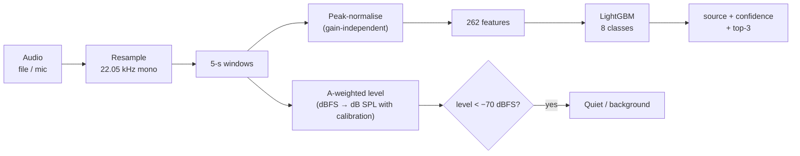

# 🧪 Methodology

[← Back to README](../README.md) · [Architecture](ARCHITECTURE.md) · [Data](DATA.md) · [Results](RESULTS.md) · [User guide](USER_GUIDE.md) · [Deployment](DEPLOYMENT.md) · [Development](DEVELOPMENT.md)

---

## Contents

1. [Acoustic fundamentals](#1-acoustic-fundamentals)
2. [Sound source classification](#2-sound-source-classification)
3. [Data quality control](#3-data-quality-control)
4. [Spatiotemporal analysis](#4-spatiotemporal-analysis)
5. [Hotspot definition](#5-hotspot-definition)
6. [Hotspot prediction](#6-hotspot-prediction)
7. [Evaluation protocol](#7-evaluation-protocol)
8. [Limitations](#8-limitations)

---

## 1. Acoustic fundamentals

| Term | Meaning |
|---|---|
| **dB(A)** | Sound level with *A-weighting*, which mimics human hearing by de-emphasising low and very high frequencies |
| **LAF** | A-weighted level with *Fast* (125 ms) time weighting, as reported by CPCB sensors |
| **LAeq** | *Equivalent continuous level*: the steady level carrying the same acoustic energy as the fluctuating sound over a period |
| **Lday / Lnight** | LAeq over 06:00–22:00 and 22:00–06:00, the periods the Indian limits use |
| **dBFS** | Level relative to a microphone's digital full scale. It becomes dB SPL only after calibration |

Decibels are logarithmic, so levels **must be averaged as energy, not arithmetically**:

$$
L_{eq} = 10 \log_{10}\left(\frac{1}{N}\sum_{i=1}^{N} 10^{L_i/10}\right)
$$

For example, an hour with 30 minutes at 60 dB and 30 minutes at 80 dB has an LAeq of **77 dB**, not 70 dB. Every aggregation in NoiseScope (hourly, Lday/Lnight, station summaries, edge-node Leq) uses this formula (`acoustics.leq`).

---

## 2. Sound source classification

### 2.1 Pipeline

### 2.2 Features (262 per window)

Each window is peak-normalised, so the predicted class does not depend on recording gain or distance. Features are the **mean and standard deviation over time** of:

| Group | Values | Captures |
|---|---|---|
| 64-band log-mel spectrogram | 128 | Overall spectral shape (engine rumble vs. horn tone vs. birdsong) |
| 20 MFCCs | 40 | Timbre |
| Δ-MFCCs | 40 | How timbre changes (sirens sweep, horns don't) |
| Spectral centroid, bandwidth, roll-off, flatness, zero-crossing rate | 10 | Brightness, noisiness, tonality |
| Spectral contrast (7 bands) | 14 | Peaks vs. valleys (tonal vs. broadband) |
| Chroma (12 pitch classes) | 24 | Pitched content (bells, alarms, horns) |
| Temporal descriptors | 6 | Onset strength statistics, loudness dynamics, fraction of loud frames (impulsive vs. steady) |

### 2.3 Model

**LightGBM** gradient-boosted trees: 500 trees, learning rate 0.05, 15 leaves, 50% feature subsampling, **balanced class weights** (horn and siren have only 40 clips each).

### 2.4 Data augmentation

Each training clip gets one augmented copy that imitates street conditions:
- **Pitch shift** of ±2 semitones (different vehicles and horns)
- **Random circular time shift** (event position within the window)
- **Background mixing** with engine, rain, wind or footsteps at **5–20 dB SNR** (busy streets)

| | Accuracy | Macro-F1 | Horn recall | Siren recall |
|---|---|---|---|---|
| Without augmentation | 83.0% | 0.816 | 0.57 | 0.72 |
| **With augmentation** | **84.6%** | **0.833** | **0.60** | **0.82** |

Augmented copies are added **only to training folds**. Scores always come from the original, unaugmented held-out clips.

### 2.5 Level estimation

A-weighting is applied in the frequency domain (STFT power × A-weighting curve), normalised so that a full-scale 1 kHz sine reads 0 dBFS. With a calibration offset (measured once next to a sound level meter: `offset = meter dB − reported dBFS`), levels become **dB SPL**, comparable with CPCB readings.

---

## 3. Data quality control

| Check | Rule |
|---|---|
| Missing | Empty value |
| Dropout | LAF < 25 dB |
| Spike | LAF > 120 dB |
| **Stuck sensor** | Rolling 18-reading (3-hour, centred) standard deviation < 0.2 dB |
| Hour completeness | ≥ 3 of 6 valid readings for an hourly LAeq |
| Day/night completeness | ≥ 75% of a period's readings for Lday / Lnight |

The threshold was chosen by inspection. Working sensors at quiet residential sites still vary by more than 0.5 dB over 3 hours, while the frozen T. Nagar sensor varied by about 0.01 dB per 10 minutes.

---

## 4. Spatiotemporal analysis

| Dimension | Analysis | Where |
|---|---|---|
| **Time of day** | Mean exceedance per station × hour; median hourly profiles | City heatmap, daily profiles |
| **Day of week** | Hour × weekday LAeq matrix per station | Station explorer |
| **Day vs night** | Daily Lday / Lnight against limits | Station explorer |
| **Space** | Per-station hotspot index on the map; zone-type comparison | Overview map, ranking |
| **Episodes** | Contiguous hotspot runs: when they **emerge**, how long they **persist**, when they **dissipate** | Hotspot episodes table and histogram |

10-minute readings are **end-labelled** (a 00:10 stamp covers 00:00–00:10), so each reading is assigned to the hour in which its interval *starts*.

---

## 5. Hotspot definition

For every station-hour:

$$
\text{exceedance} = L_{Aeq,\,hour} - \text{limit}(\text{zone}, \text{day/night})
$$

| Status | Rule |
|---|---|
| 🟢 Compliant | exceedance ≤ 0 dB |
| 🟠 Exceeding | 0 < exceedance ≤ 10 dB |
| 🔴 **Hotspot** | exceedance > 10 dB |

The 10 dB margin marks a *serious* problem rather than a marginal breach: +10 dB is roughly a doubling of perceived loudness.

**Station hotspot index (0–100):**

$$
\text{index} = 0.6 \times \text{hotspot hours \%} + 40 \times \min\left(\frac{\max(\overline{\text{exceedance}},\,0)}{20},\,1\right)
$$

This combines *how often* a site is a hotspot with *how far* it exceeds its limit (saturating at 20 dB).

---

## 6. Hotspot prediction

### 6.1 Problem framing

At each issue hour *t*, with observations up to *t*, predict for every horizon *h* ∈ {1, 2, 3, 6, 12, 24} hours:
1. the hourly LAeq at *t + h* (point forecast),
2. an 80% prediction range,
3. **P(hotspot at t + h)**.

### 6.2 Model

A **direct multi-horizon** approach: one model for all horizons, with the horizon as a feature. That gives no error build-up from recursive forecasting, and lets the model share information across horizons.

| Output | Model |
|---|---|
| Point forecast | LightGBM, L1 loss, target = **change from the current level** (*y*t+h − *y*t) |
| 80% range | Two LightGBM quantile models (5th and 95th percentile of the change) |
| P(hotspot) | LightGBM binary classifier |

All use 300 trees, learning rate 0.03, 15 leaves, at least 100 samples per leaf, and 80% row and column subsampling.

### 6.3 Features (14)

| Feature | Description |
|---|---|
| `horizon` | Hours ahead |
| `lag0` | Current hourly LAeq |
| `d_lag1`, `d_lag2` | Previous two hours, relative to now |
| `d_mean3`, `d_mean24` | 3-hour and 24-hour energy averages, relative to now |
| `slope3` | Trend over the last 2 hours |
| `d_yday` | Same hour yesterday (target hour − 24 h), relative to now |
| `d_profile`, `profile_std` | Station's typical level and variability at the target hour (from training data only) |
| `d_limit` | Target-hour legal limit, relative to now |
| `target_hour`, `target_night` | Time of day of the target |
| `zone_code` | Industrial / Commercial / Residential / Silence |

### 6.4 What was tried and rejected

| Variant | 1 h MAE | 6 h MAE | Decision |
|---|---|---|---|
| Absolute target, all features | 3.15 | 3.89 | ✗ worse than persistence at short horizons |
| Change target | 2.66 | 3.67 | ✓ better |
| + drop day-of-week (only ~4 weeks per station, so it overfits) | 2.56 | 3.57 | ✓ |
| + stronger regularisation, drop "same hour last week" | **2.48** | **3.55** | ✓ **final** |
| Quantiles 10/90 → **5/95** | — | — | ✓ coverage 72% → 83% (nominal 80%) |

---

## 7. Evaluation protocol

### Sound classifier
- **ESC-50's official 5 folds.** Clips cut from the same original recording share a fold, which prevents leakage.
- Metrics: accuracy, balanced accuracy, macro-F1, per-class precision and recall, confusion matrix.

### Forecaster
- **Strictly chronological, per station.** The first 70% of each station's hours train the model; the last 30% test it.
- Training rows must have their **target** inside the training period, so there is no look-ahead.
- The station profile feature is computed from the training period only.
- **Baselines:**
  - *Persistence*: the next hours equal the last hour
  - *Same hour yesterday*
  - *Station hourly profile*: the training-period mean for that hour
- Metrics: MAE and RMSE (dB), hotspot AUC, Brier score, F1 against persistence, and 80% range coverage.

---

## 8. Limitations

- About **one month per station**, in different months (May 2025 – Feb 2026). There is not enough data for seasonal or annual patterns yet. The live poller exists to fix this.
- The forecaster trains on pooled stations. A station's first hours after a sensor fault, or an unseen event such as a festival, will forecast poorly.
- ESC-50 is not recorded in Chennai. Local sounds (auto-rickshaw horns, temple bells, metro construction) are approximated by the nearest ESC-50 classes.
- Horn recall is 60%: horns are short, and are often confused with animals or traffic.
- Station coordinates are approximate, so there is no spatial interpolation between stations.
- Edge levels without calibration are relative (dBFS).
