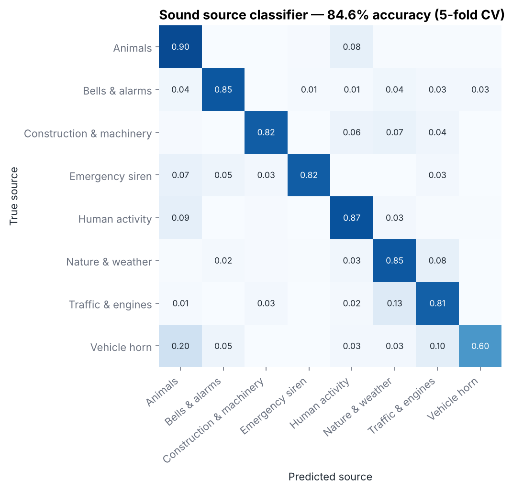
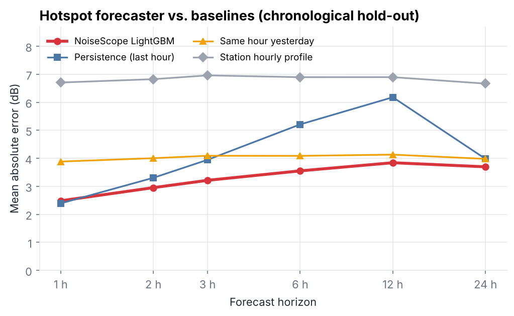
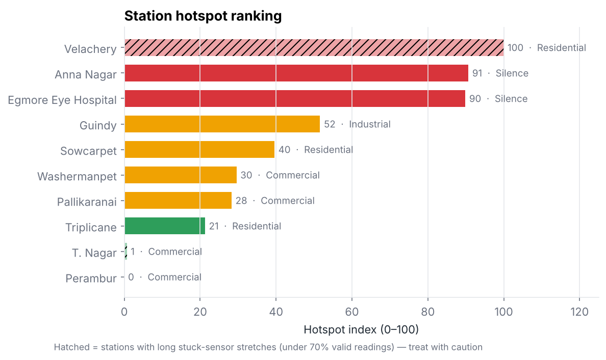
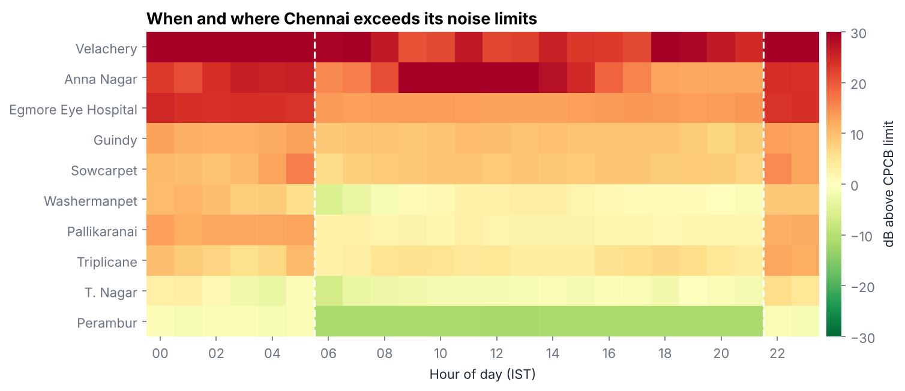
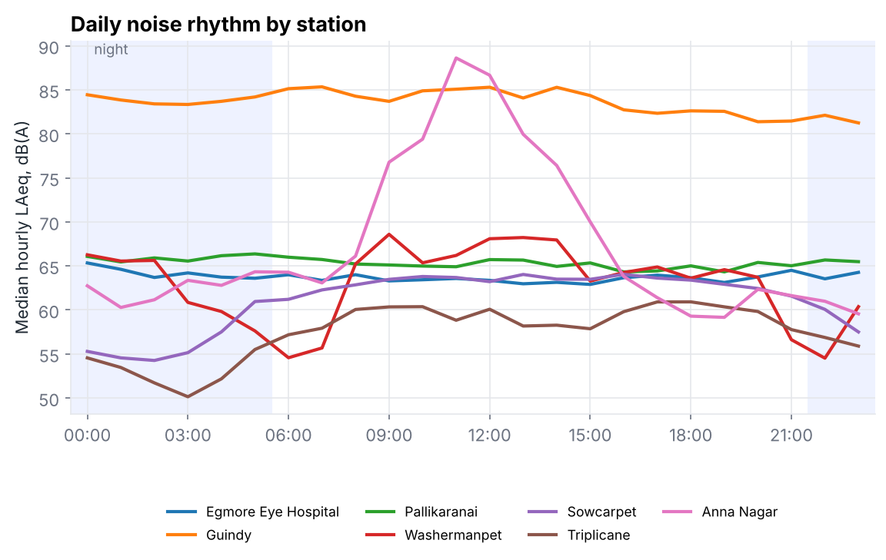
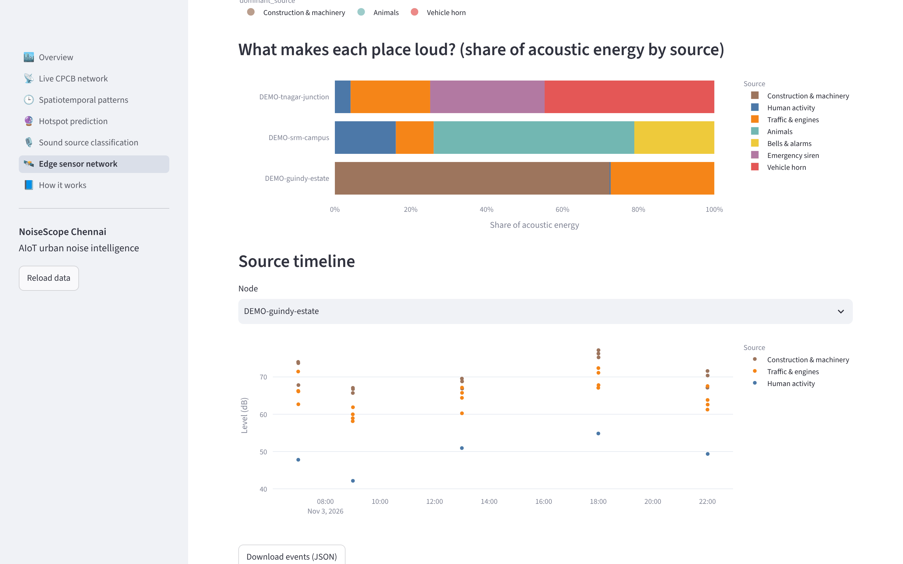

# 📊 Results

[← Back to README](../README.md) · [Architecture](ARCHITECTURE.md) · [Data](DATA.md) · [Methodology](METHODOLOGY.md) · [User guide](USER_GUIDE.md) · [Deployment](DEPLOYMENT.md) · [Development](DEVELOPMENT.md)

All numbers below are reproducible with `python scripts/train_sound_classifier.py`, `python scripts/train_forecaster.py` and `python scripts/make_figures.py`.

---

## 1. Sound source classification

**ESC-50 official 5-fold cross-validation, 1,160 clips, 8 urban categories.**

| Accuracy | Balanced accuracy | Macro-F1 | Fold accuracy range |
|---|---|---|---|
| **84.6%** | 81.6% | **0.833** | 82.8–86.6% |

| Category | Precision | Recall | F1 | Clips |
|---|---|---|---|---|
| 🐕 Animals | 0.85 | 0.90 | 0.87 | 240 |
| 🔔 Bells & alarms | 0.88 | 0.85 | 0.87 | 80 |
| 🏗️ Construction & machinery | 0.92 | 0.82 | 0.87 | 120 |
| 🚨 Emergency siren | 0.89 | 0.82 | 0.86 | 40 |
| 👥 Human activity | 0.84 | 0.87 | 0.85 | 240 |
| 🌧️ Nature & weather | 0.84 | 0.85 | 0.84 | 240 |
| 🚗 Traffic & engines | 0.79 | 0.81 | 0.80 | 160 |
| 📯 Vehicle horn | 0.86 | 0.60 | 0.71 | 40 |

**Reading the confusion matrix**
- The strongest classes (animals, bells, construction, sirens) have distinctive spectral or temporal signatures.
- **Traffic ↔ nature** confusion (13%) comes from steady broadband noise: engine rumble and rain or wind look alike spectrally.
- **Horns** are the hardest class: only 40 training clips, very short events, and 20% are confused with animals (horn and animal calls are both short tonal bursts). Augmentation lifted horn recall from 0.57 to 0.60 and siren recall from 0.72 to 0.82.

---

## 2. Hotspot forecasting

**Chronological hold-out: last 30% of each station's hours, 9,949 forecasts.**

### 2.1 Level forecast error

**Mean absolute error (dB)**

| Method | 1 h | 2 h | 3 h | 6 h | 12 h | 24 h |
|---|---|---|---|---|---|---|
| **NoiseScope LightGBM** | 2.48 | **2.95** | **3.21** | **3.55** | **3.84** | **3.70** |
| Persistence (last hour) | **2.39** | 3.30 | 3.95 | 5.21 | 6.18 | 3.98 |
| Same hour yesterday | 3.88 | 4.00 | 4.09 | 4.09 | 4.13 | 3.98 |
| Station hourly profile | 6.71 | 6.83 | 6.96 | 6.90 | 6.90 | 6.67 |

**Root mean squared error (dB)**

| Method | 1 h | 2 h | 3 h | 6 h | 12 h | 24 h |
|---|---|---|---|---|---|---|
| **NoiseScope LightGBM** | **4.42** | **5.16** | **5.42** | **5.72** | **6.07** | **6.29** |
| Persistence (last hour) | 4.68 | 6.11 | 6.91 | 8.87 | 9.92 | 7.05 |
| Same hour yesterday | 6.87 | 6.92 | 7.00 | 6.99 | 7.04 | 7.05 |
| Station hourly profile | 9.97 | 10.07 | 10.19 | 10.11 | 10.11 | 9.93 |

**Takeaways**
- At **1 hour**, "same as now" is marginally better on MAE (2.39 vs 2.48 dB), but NoiseScope already has lower RMSE, meaning fewer large misses.
- From **2 hours onward NoiseScope wins clearly**: 32% lower MAE at 6 h and 38% lower at 12 h than persistence.
- It also beats "same hour yesterday" at every horizon. The model learns *when* to trust the daily rhythm and when to trust the current level.

### 2.2 Hotspot probability

| Horizon | Test forecasts | Hotspot rate | AUC | Brier | F1 (model) | F1 (persistence) |
|---|---|---|---|---|---|---|
| 1 h | 1,797 | 42.9% | **0.981** | 0.050 | 0.919 | 0.922 |
| 2 h | 1,723 | 43.8% | **0.972** | 0.060 | 0.907 | 0.894 |
| 3 h | 1,663 | 44.7% | **0.964** | 0.070 | 0.897 | 0.877 |
| 6 h | 1,631 | 44.5% | **0.953** | 0.078 | 0.877 | 0.860 |
| 12 h | 1,561 | 44.9% | **0.943** | 0.084 | 0.876 | 0.845 |
| 24 h | 1,574 | 43.4% | **0.941** | 0.080 | 0.880 | 0.863 |

AUC above 0.94 at every horizon means the hotspot probabilities rank risky hours very reliably. The low Brier scores (0.05–0.08) mean the probabilities are also well calibrated.

### 2.3 Prediction range

| Horizon | 1 h | 2 h | 3 h | 6 h | 12 h | 24 h |
|---|---|---|---|---|---|---|
| Actual value inside the "80% range" | 85% | 82% | 82% | 83% | 83% | 83% |

### 2.4 Per-station error at 6 hours ahead (MAE, dB)

| Station | NoiseScope | Persistence | |
|---|---|---|---|
| Anna Nagar | **7.37** | 15.68 | festival spikes; 53% lower error |
| Sowcarpet | **1.02** | 4.05 | |
| Triplicane | **1.90** | 5.30 | |
| Guindy | **3.66** | 4.58 | |
| Washermanpet | **2.86** | 3.04 | |
| Egmore Eye Hospital | **1.96** | 2.13 | |
| Perambur ⚠ | **0.38** | 0.55 | |
| Velachery ⚠ | 9.08 | 9.01 | faulty sensor |
| Pallikaranai | 5.26 | **3.29** | level shift between training and test periods |
| T. Nagar ⚠ | 1.83 | **0.22** | few valid hours |

### 2.5 What the model relies on

| Feature | Share of model gain |
|---|---|
| Station's typical level at the target hour (`d_profile`) | 41.6% |
| Station's variability at that hour (`profile_std`) | 14.6% |
| Same hour yesterday (`d_yday`) | 11.4% |
| 24-hour average (`d_mean24`) | 7.3% |
| Current level (`lag0`) | 6.2% |
| Horizon | 4.6% |
| Legal limit at target hour | 4.1% |

**The city's daily rhythm is the strongest predictor of future noise**, followed by yesterday's pattern and the recent trend.

---

## 3. Chennai noise findings

### 3.1 Station profile

| Station | Zone | Lday | Lnight | Limits | Median hourly LAeq | Hotspot hours | Hotspot index |
|---|---|---|---|---|---|---|---|
| Anna Nagar | Silence | 98.0 | 87.6 | 50/40 | 65.4 | 85% | 91 |
| Egmore Eye Hospital | Silence | 64.2 | 64.8 | 50/40 | 63.7 | 93% | 90 |
| Guindy | Industrial | 89.3 | 89.1 | 75/70 | 83.7 | 52% | 52 |
| Sowcarpet | Residential | 63.9 | 58.1 | 55/45 | 62.4 | 34% | 40 |
| Washermanpet | Commercial | 82.9 | 81.5 | 65/55 | 63.6 | 39% | 30 |
| Pallikaranai | Commercial | 71.3 | 71.4 | 65/55 | 65.4 | 29% | 28 |
| Triplicane | Residential | 60.7 | 56.3 | 55/45 | 58.1 | 15% | 21 |
| Velachery ⚠ | Residential | 97.4 | 94.4 | 55/45 | 83.6 | 100% | 100 |
| T. Nagar ⚠ | Commercial | 78.2 | 58.2 | 65/55 | 62.4 | 1% | 1 |
| Perambur ⚠ | Commercial | 53.6 | 54.1 | 65/55 | 53.5 | 0% | 0 |

⚠ = under 70% valid data after stuck-sensor removal. Lday and Lnight are energy averages, so a few very loud hours (e.g. festivals) dominate them. The median hourly level shows the typical hour.

### 3.2 When and where

### 3.3 Key findings

1. **78% of all station-hours exceed the legal limit.** Non-compliance is the norm, not the exception.
2. **Silence zones are the worst relative offenders.** Egmore Eye Hospital is more than 10 dB over its limit for 93% of hours. Its level barely changes between day (64.2 dB) and night (64.8 dB), so at night it exceeds the limit by about 25 dB.
3. **Nights are the biggest compliance gap.** Limits drop by 5–10 dB at 22:00, but sound levels at most stations fall only slightly. The heatmap glows red at night.
4. **Festival hotspots.** Anna Nagar's daytime levels spike to over 100 dB during **Bhogi/Pongal (14–19 Jan 2026)**, the clearest event-driven hotspot in the data.
5. **Industrial Guindy is loud around the clock.** Its median hourly level is about 84 dB, with almost no day/night difference.
6. **Residential areas show the clearest human rhythm.** Sowcarpet and Triplicane quieten to about 50–55 dB around 03:00 and rise from 05:00, following the city's waking hours.
7. **Monitoring infrastructure is a weak point.** 3 of 10 sensors had long frozen stretches. Without automatic quality control, the faulty Velachery sensor would have been ranked Chennai's worst hotspot.

### 3.4 Cross-check with TNPCB annual figures (2023-24)

| Station | TNPCB annual day Leq | NoiseScope Lday (one month) |
|---|---|---|
| Eye Hospital, Egmore | 65 | 64.2 |
| Guindy | 66 | 89.3 |
| Pallikaranai | 67 | 71.3 |
| Triplicane | 64 | 60.7 |
| Sowcarpet | 56 | 63.9 |

Egmore matches closely. The Guindy gap suggests a change in conditions or sensor between the periods, which is worth investigating with longer live data.

---

## 4. Edge-node source attribution (demo)

The three demo nodes (built from ESC-50 clips, **not field data**) show what the system produces once real edge nodes are deployed: a breakdown of *what* makes each place loud. Here that is horns and sirens at a junction, machinery at an industrial estate, and people, bells and birds on a campus.
