# 🖥️ User guide

[← Back to README](../README.md) · [Architecture](ARCHITECTURE.md) · [Data](DATA.md) · [Methodology](METHODOLOGY.md) · [Results](RESULTS.md) · [Deployment](DEPLOYMENT.md) · [Development](DEVELOPMENT.md)

**Live app:** https://noisescope.streamlit.app/ · **Run locally:** `streamlit run app.py`

The sidebar has seven pages. **Reload data** (bottom of the sidebar) clears the caches after new data arrives.

| # | Page | Answers the question |
|---|---|---|
| 1 | 🏙️ Overview | Where are Chennai's noise hotspots? |
| 2 | 📡 Live CPCB network | What are the stations reading right now? |
| 3 | 🕒 Spatiotemporal patterns | When and where are limits exceeded? |
| 4 | 🔮 Hotspot prediction | Which places will be hotspots in the next 24 hours? |
| 5 | 🎙️ Sound source classification | What is making this sound? |
| 6 | 🛰️ Edge sensor network | What makes each place loud? |
| 7 | 📘 How it works | How does the system work, and how good is the data? |

> Screenshots were captured offline, so maps appear without the street basemap. The live app shows the full OpenStreetMap/Carto map.

---

## 1. 🏙️ Overview

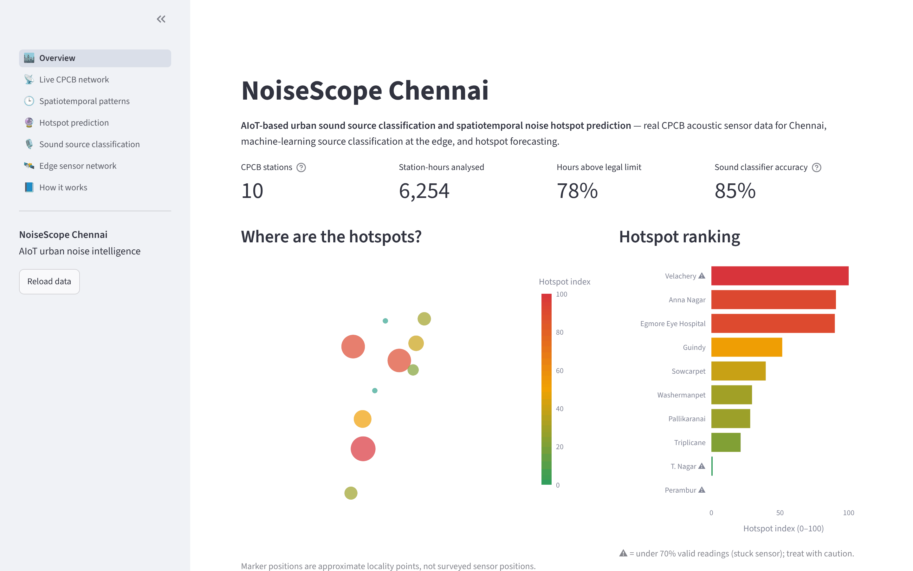

- **Headline metrics:** stations, station-hours analysed, share of hours above the legal limit, and classifier accuracy.
- **Map:** each station coloured and sized by its **hotspot index** (0–100). Hover for zone, Lday, Lnight and hotspot share.
- **Hotspot ranking:** stations with unreliable sensors are marked **⚠**.
- **Key findings:** generated automatically from the current data, using reliable stations only.

---

## 2. 📡 Live CPCB network

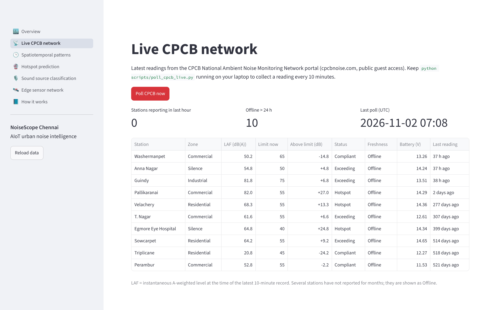

- **Poll CPCB now** fetches the latest reading from every station (about 10 seconds).
- **Freshness:** *Live* (reported within the last hour), *Today*, or *Offline* (no report in more than 24 h).
- **Status** compares the latest reading with the limit that applies at that hour.
- If some stations don't answer, **Details for N station(s)** explains why: connection refused, timeout, or an empty answer. Failed polls never erase earlier readings.

> The CPCB portal may refuse requests from cloud servers outside India. For continuous live data, run `python scripts/poll_cpcb_live.py --interval 600` on your laptop.

---

## 3. 🕒 Spatiotemporal patterns

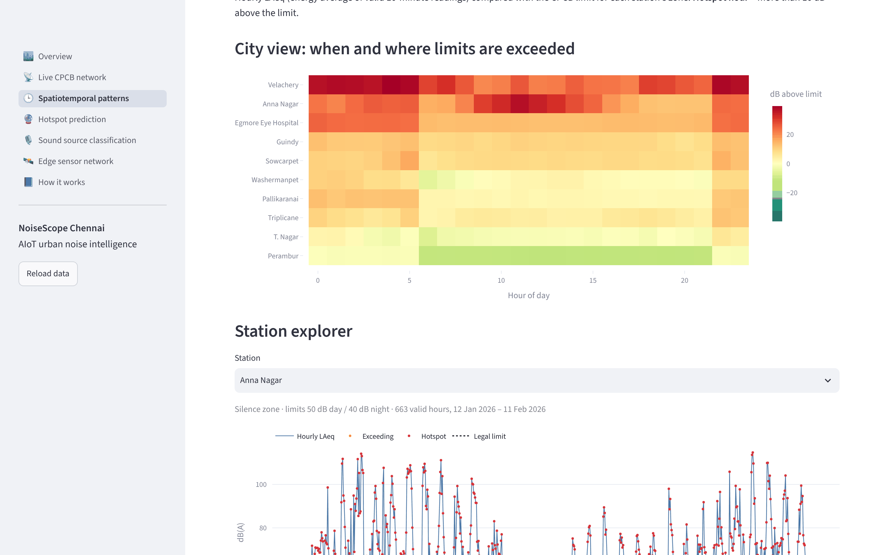

**City view.** A station × hour-of-day heatmap of the average dB above the limit. Red means over the limit, green means under it.

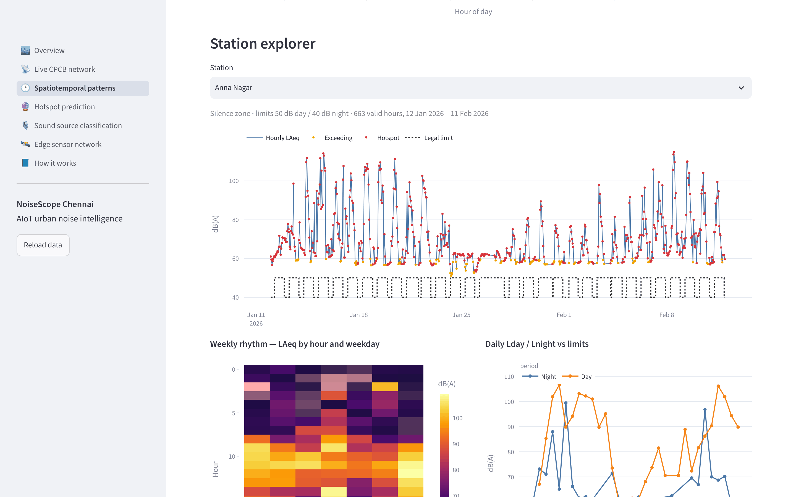

**Station explorer** (pick any station):
- **Hourly LAeq time series**, with each hour coloured by status (compliant, exceeding, hotspot) and the legal limit as a dotted step line.
- **Weekly rhythm:** LAeq by hour × weekday.
- **Daily Lday / Lnight** against the day and night limits.

**Hotspot episodes.** Runs of 3 or more consecutive hotspot hours per station: how many there are, how long they last, the longest one, its peak level, and a histogram of *when* episodes begin.

---

## 4. 🔮 Hotspot prediction

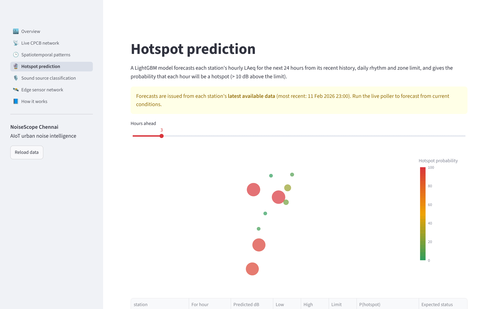

1. Move the **Hours ahead** slider (1–24).
2. The **map** colours each station by **P(hotspot)** at that horizon.
3. The **table** lists the predicted level, the 80% range (Low–High), the limit, the probability and the expected status.
4. **24-hour outlook:** pick a station to see the last 48 h observed (blue), the forecast (red) with its shaded 80% range, and the limit.

> If the warning says forecasts are issued from the "latest available data", the station has no recent readings. Run the live poller to forecast from current conditions.

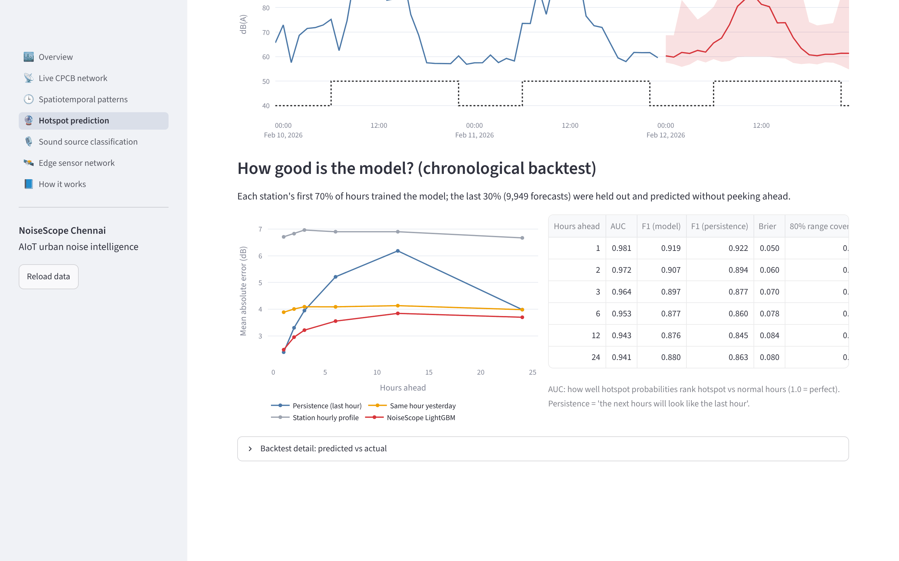

**How good is the model?** Forecast error against three simple baselines, plus hotspot AUC, F1 and range coverage for each horizon. Expand **Backtest detail** to compare predicted and actual levels for any station and horizon.

---

## 5. 🎙️ Sound source classification

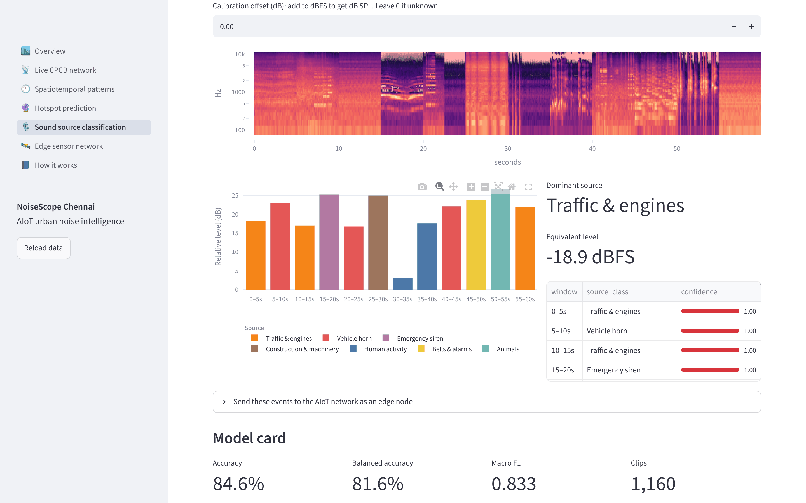

Three ways to provide audio:
- **🎙️ Record:** use your browser microphone (allow access when asked).
- **📁 Upload:** a WAV, OGG, FLAC, MP3 or M4A file.
- **▶️ Demo street mix:** a bundled 60-second mix.

What you get:
- the **spectrogram**
- a **timeline** of 5-second windows, coloured by predicted source, with bar height showing relative level
- the **dominant source** and the **equivalent level**
- a per-window table with **confidence**

**Calibration offset:** leave it at 0 for relative dBFS levels. To get real dB SPL, enter `meter dB − reported dBFS`, measured once next to a sound level meter.

**Send these events to the AIoT network:** give a node id and a location, and the windows are logged as edge events. They then appear on the Edge sensor network page.

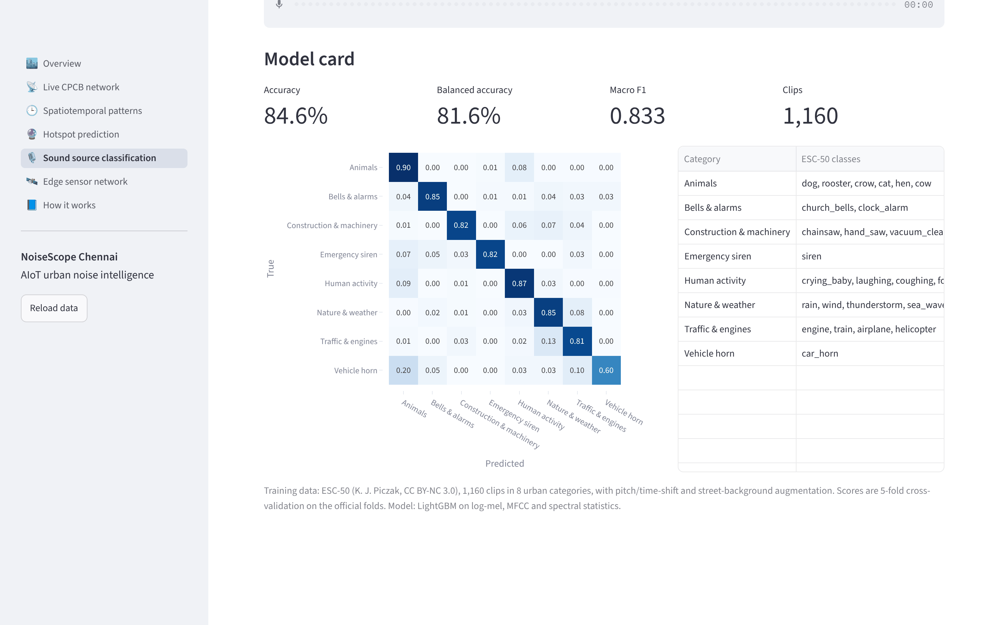

The **model card** shows cross-validated accuracy, the confusion matrix, and how ESC-50 classes map to the urban categories.

---

## 6. 🛰️ Edge sensor network

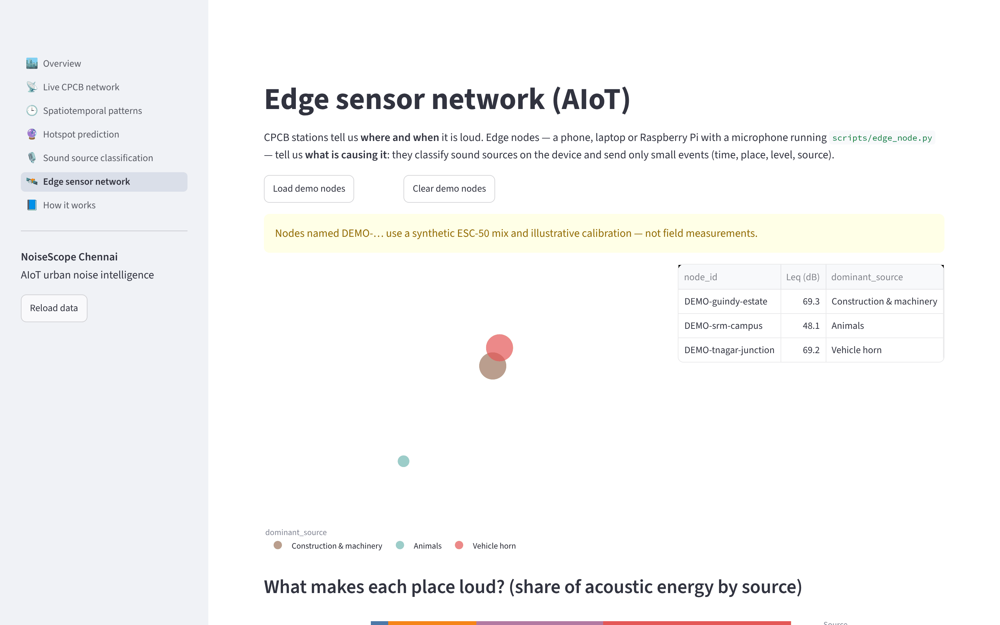

- **Load demo nodes** creates three illustrative nodes (T. Nagar junction, Guindy estate, SRM campus). **Clear demo nodes** removes them.
- **Map and table:** each node's Leq, its dominant source (by acoustic energy) and its **man-made share** of the energy.

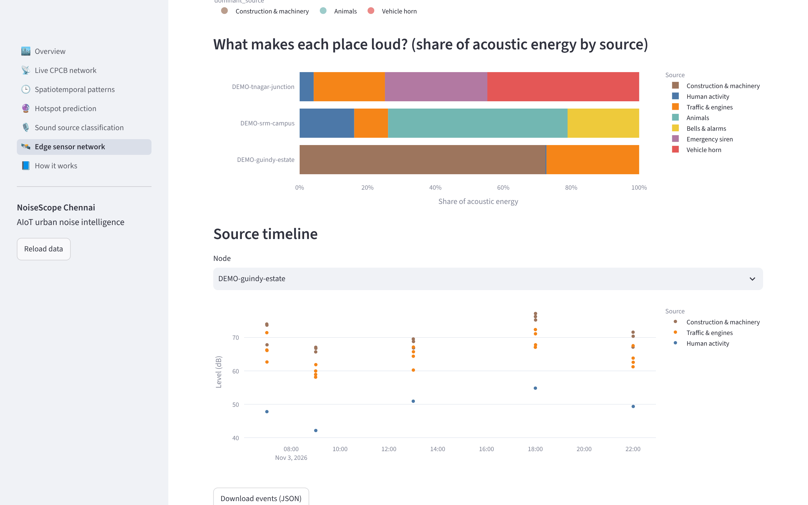

- **What makes each place loud?** The share of acoustic energy from each source, per node.
- **Source timeline:** every event's level, coloured by source, for the chosen node.
- **Download events (JSON)** exports a node's data.

---

## 7. 📘 How it works

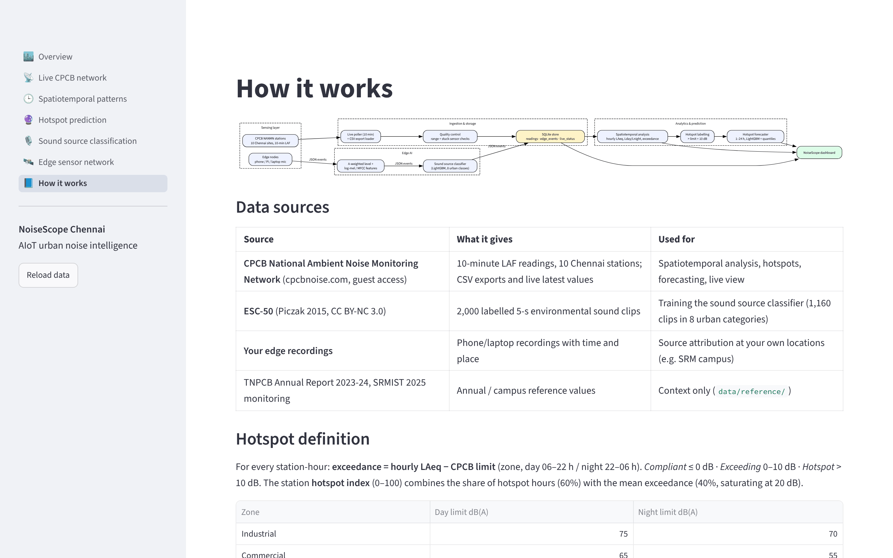

The architecture diagram, data sources, hotspot definition, legal limits, a **per-station data-quality table** (valid % and stuck-sensor %), and limitations.
